<p align="center">
  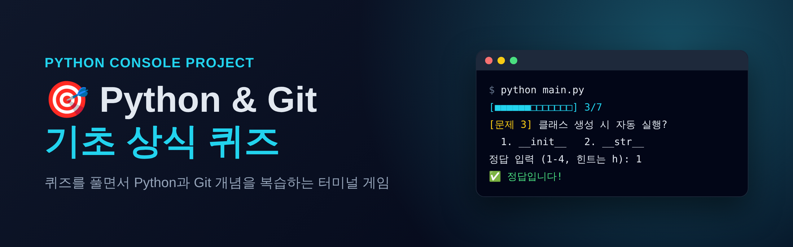
</p>

<p align="center">
  <a href="https://bomigrace-byte.github.io/quiz-game/"></a>
  <a href="#학습-목표-달성-현황"></a>
  <a href="#3-실행-방법"></a>
  <a href="#9-개념-학습-가이드"></a>
</p>

<p align="center">
  
  
  
  
</p>

<p align="center">
  <b>터미널에서 동작하는 4지선다 퀴즈 게임</b><br>
  퀴즈를 풀면서 Python과 Git 개념을 복습하고, 점수와 기록은 <code>state.json</code>에 저장됩니다.
</p>

<p align="center">
  <sub>이 README는 <b>프로젝트 설명서</b>이자 이 과제에서 배운 개념을 정리한 <b>학습 노트</b>입니다.</sub>
</p>

---

<h3 align="center">✨ 한눈에 보기</h3>

<p align="center">
  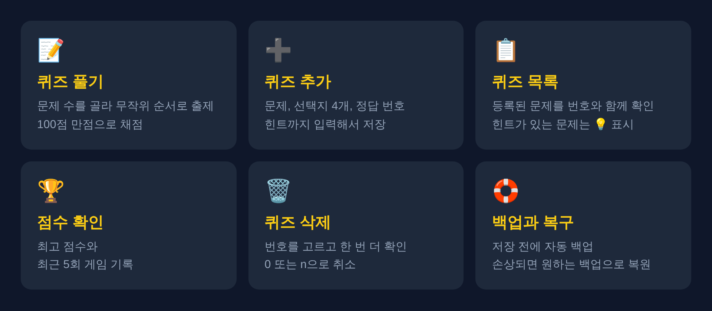
</p>

<h3 align="center">🚀 빠른 시작</h3>

```bash
git clone https://github.com/bomigrace-byte/quiz-game.git
cd quiz-game
python main.py
```

<h3 align="center">📚 목차</h3>

<p align="center">
  <b>📖 프로젝트 설명</b><br>
  <a href="#1-프로젝트-개요">프로젝트 개요</a> · <a href="#2-퀴즈-주제-및-선정-이유">주제 선정 이유</a> · <a href="#3-실행-방법">실행 방법</a> · <a href="#4-기능-목록">기능 목록</a> · <a href="#5-파일-구조">파일 구조</a><br>
  <a href="#6-프로그램-실행-흐름">실행 흐름</a> · <a href="#7-데이터-파일-설명-statejson">데이터 파일</a> · <a href="#데이터-백업과-복구">백업과 복구</a> · <a href="#8-실행-화면">실행 화면</a>
</p>

<p align="center">
  <b>🧠 학습 노트</b><br>
  <a href="#학습-목표-달성-현황"><b>🎯 학습 목표 달성 현황</b></a> · <a href="#기본-개념-정리"><b>📘 기본 개념 정리</b></a><br>
  <a href="#9-1-python-기초">Python 기초</a> · <a href="#9-2-클래스와-객체">클래스와 객체</a> · <a href="#9-3-파일-입출력과-예외-처리">파일 입출력과 예외</a> · <a href="#9-4-보너스-기능에-쓰인-개념">보너스 기능 개념</a> · <a href="#9-5-git-기초">Git 기초</a><br>
  <a href="#10-동료-평가-코드-설명-포인트">동료 평가 설명 포인트</a> · <a href="#15-과제-목표-셀프-체크리스트">셀프 체크리스트</a>
</p>

<p align="center">
  <b>🛠️ 개발 기록</b><br>
  <a href="#11-git-작업-기록">Git 작업 기록</a> · <a href="#12-커밋-규칙">커밋 규칙</a> · <a href="#13-대량-데이터-처리-분석-퀴즈-1000개-이상">대량 데이터 분석</a> · <a href="#14-요구사항-변경-시-수정-위치">요구사항 변경 시 수정 위치</a>
</p>

---


## 학습 목표 달성 현황

미션 가이드의 **학습 목표 15개**를 이 프로젝트의 어디에서 구현했는지 정리했습니다.<br>
**📘 개념**은 일반적인 설명, **🔍 코드 설명**은 이 프로젝트 코드로 한 설명과 예상 질문입니다.

### 🐍 Python 기초

**1. 변수의 의미와 사용 이유** &nbsp; [📘 개념](#개념-1-변수) · [🔍 코드 설명](#변수)<br>
💻 **구현:** `play()`의 `correct`, `earned`<br>
▶️ **시연:** 퀴즈를 풀고 결과 점수 확인

**2. `int`, `str`, `bool`, `list`, `dict`의 차이** &nbsp; [📘 개념](#개념-2-자료형-int-str-bool-list-dict) · [🔍 코드 설명](#자료형-int-str-bool-list-dict)<br>
💻 **구현:** `Quiz.__init__()`, `add_history()`<br>
▶️ **시연:** `state.json`을 열어 자료형 확인

**3. `if/elif/else` 조건 분기** &nbsp; [📘 개념](#개념-3-조건문-if--elif--else) · [🔍 코드 설명](#조건문-if--elif--else)<br>
💻 **구현:** `run()`의 메뉴 분기<br>
▶️ **시연:** 메뉴 1~6 선택

**4. `for`와 `while`의 차이와 선택** &nbsp; [📘 개념](#개념-4-반복문-for-vs-while) · [🔍 코드 설명](#반복문-for-vs-while)<br>
💻 **구현:** `play()`의 for, `get_number()`의 while<br>
▶️ **시연:** 정해진 문제 수만큼 출제 / 잘못된 입력은 다시 묻기

**5. 함수, 매개변수, 반환값** &nbsp; [📘 개념](#개념-5-함수-정의-매개변수-반환값) · [🔍 코드 설명](#함수-정의-매개변수-반환값)<br>
💻 **구현:** `get_number(prompt, min_value, max_value)`<br>
▶️ **시연:** 메뉴·정답·삭제에서 범위만 바꿔 재사용

### 🧱 클래스와 객체

**6. 클래스의 의미와 사용 이유** &nbsp; [📘 개념](#개념-6-클래스) · [🔍 코드 설명](#클래스란)<br>
💻 **구현:** `Quiz`, `QuizGame`, `BackupManager`<br>
▶️ **시연:** 파일 3개로 역할 분리

**7. `__init__`과 `self`의 역할** &nbsp; [📘 개념](#개념-7-__init__과-self) · [🔍 코드 설명](#__init__과-self)<br>
💻 **구현:** `Quiz.__init__()`, `Quiz.is_correct()`<br>
▶️ **시연:** 문제마다 다른 정답으로 채점

**8. 속성과 메서드 정의·활용** &nbsp; [📘 개념](#개념-8-속성과-메서드) · [🔍 코드 설명](#속성attribute과-메서드method)<br>
💻 **구현:** `quiz.answer`(속성), `quiz.is_correct()`(메서드)<br>
▶️ **시연:** 퀴즈 목록, 퀴즈 풀기

### 💾 파일 입출력

**9. 파일 열기·읽기·쓰기** &nbsp; [📘 개념](#개념-9-파일-열기--읽기--쓰기) · [🔍 코드 설명](#파일-열기--읽기--쓰기)<br>
💻 **구현:** `load()`, `save()`의 `with open(..., encoding="utf-8")`<br>
▶️ **시연:** 퀴즈 추가 → 종료 → 다시 실행해도 데이터 유지

**10. JSON의 의미와 사용 이유** &nbsp; [📘 개념](#개념-10-json) · [🔍 코드 설명](#json)<br>
💻 **구현:** `json.load()`, `json.dump()`, `to_dict()`, `from_dict()`<br>
▶️ **시연:** `state.json` 내용 보기

**11. `try/except` 오류 처리** &nbsp; [📘 개념](#개념-11-try--except) · [🔍 코드 설명](#try--except)<br>
💻 **구현:** `get_number()`, `load()`, `main()`<br>
▶️ **시연:** `abc` 입력, `state.json` 손상, `Ctrl+C`

### 🌿 Git 기초

**12. Git의 의미와 필요성** &nbsp; [📘 개념](#개념-12-git) · [🔍 코드 설명](#git이란-왜-필요한가)<br>
💻 **구현:** 기능 단위 커밋 이력<br>
▶️ **시연:** `git log --oneline`

**13. `init` `add` `commit` `push` `pull` `checkout` `clone`** &nbsp; [📘 개념](#개념-13-git-명령어-7종) · [🔍 코드 설명](#명령어-7종)<br>
💻 **구현:** [11. Git 작업 기록](#11-git-작업-기록)<br>
▶️ **시연:** `git log --oneline --graph`

**14. 브랜치 생성과 병합** &nbsp; [📘 개념](#개념-14-브랜치-생성과-병합) · [🔍 코드 설명](#브랜치와-병합)<br>
💻 **구현:** `feature/` 브랜치에서 작업 → `merge --no-ff`<br>
▶️ **시연:** 그래프에서 갈라졌다 합쳐진 선 확인

**15. `clone`과 `pull`로 변경사항 가져오기** &nbsp; [📘 개념](#개념-15-clone과-pull) · [🔍 코드 설명](#clone과-pull의-차이)<br>
💻 **구현:** clone 폴더에서 수정 → 원래 폴더에서 pull ([실습 기록](#clone--pull-실습))<br>
▶️ **시연:** 공용 컴퓨터에서 `git clone`으로 받아 실행

> 15개 항목을 스스로 점검하려면 [과제 목표 셀프 체크리스트](#15-과제-목표-셀프-체크리스트)를 사용하세요.

---

## 기본 개념 정리

학습 목표 15개의 **일반적인 개념**을 정리했습니다. 이 프로젝트 코드로 설명한 내용은 [9. 개념 학습 가이드](#9-개념-학습-가이드)에 있습니다.

> **설명 순서 추천:** ① 일반 개념(💬 문장) → ② 내 코드에서 쓴 곳([학습 목표 표](#학습-목표-달성-현황)의 "구현한 곳") → ③ 시연

### 🐍 Python 기초

#### 개념 1. 변수

**값에 붙이는 이름표**입니다. 이름으로 값을 저장해 두었다가 다시 꺼내 쓰거나 바꿀 수 있습니다.

```python
age = 20          # 20이라는 값에 age라는 이름을 붙임
age = age + 1     # 값을 바꿔서 다시 저장 → 21
print(age)        # 이름으로 값을 꺼내 씀
```

- **재사용:** 같은 값을 여러 곳에서 이름으로 부를 수 있습니다.
- **변화 추적:** 반복하면서 바뀌는 값(합계, 개수)을 기억할 수 있습니다.
- **읽기 쉬움:** `0.1` 대신 `tax_rate`라고 쓰면 의미가 드러납니다.
- **정확히는:** Python의 변수는 값이 담긴 상자라기보다, 메모리에 있는 값을 **가리키는 이름**입니다. `=`는 "같다"가 아니라 "오른쪽 값에 왼쪽 이름을 붙인다"(대입)라는 뜻입니다.

> 💬 "변수는 값에 붙이는 이름이에요. 값을 저장해 두고 다시 쓰거나, 바뀌는 값을 추적하려고 씁니다."

#### 개념 2. 자료형: int, str, bool, list, dict

값의 **종류**입니다. 종류에 따라 할 수 있는 연산이 다릅니다.

| 자료형 | 의미 | 예시 | 특징 |
|---|---|---|---|
| `int` | 정수 | `3`, `-10` | 사칙연산 가능 |
| `str` | 문자열 | `"hello"`, `"3"` | `"3"`은 숫자가 아니라 글자 |
| `bool` | 참/거짓 | `True`, `False` | 조건문에서 사용 |
| `list` | 순서 있는 묶음 | `[1, 2, 3]` | 번호(0부터)로 꺼냄 |
| `dict` | 키:값 묶음 | `{"age": 20}` | 이름(키)으로 꺼냄 |

```python
"3" + "4"      # "34"  (글자 이어 붙이기)
3 + 4          # 7     (숫자 더하기)
int("3") + 4   # 7     (형 변환 후 계산)

scores = [90, 80, 70]
scores[0]                  # 90 → 번호로 꺼냄

student = {"name": "철수", "age": 20}
student["name"]            # "철수" → 이름으로 꺼냄
```

- `input()`은 **항상 str**을 돌려줍니다. 숫자로 계산하려면 `int()`로 바꿔야 합니다.
- **list와 dict 고르는 법:** 같은 종류를 순서대로 모으면 list, 항목마다 의미(이름)가 다르면 dict

> 💬 "int는 정수, str은 글자, bool은 참/거짓이고, list는 번호로 찾는 묶음, dict는 이름으로 찾는 묶음이에요."

#### 개념 3. 조건문: if / elif / else

조건에 따라 **다른 코드를 실행**하게 만드는 문법입니다.

```python
score = 85

if score >= 90:
    grade = "A"
elif score >= 80:      # 위 조건이 거짓일 때만 검사
    grade = "B"
else:                  # 위의 모든 조건이 거짓일 때
    grade = "C"
# 결과: "B"
```

- **위에서부터 차례로 검사**하고, 처음 참인 블록 **하나만** 실행합니다.
- `elif`는 여러 개 쓸 수 있고, `else`는 없어도 됩니다.
- 조건식에는 비교(`==`, `!=`, `>`, `<=`)와 논리(`and`, `or`, `not`)를 씁니다.
- **들여쓰기**가 블록의 범위를 정합니다.
- `if`를 여러 개 쓰면 조건을 **각각 전부** 검사합니다. 여러 경우 중 **하나만** 골라야 하면 `elif`를 씁니다.

> 💬 "조건에 따라 다른 동작을 하게 하는 문법이에요. 위에서부터 검사해서 처음 참인 것 하나만 실행합니다."

#### 개념 4. 반복문: for vs while

| | `for` | `while` |
|---|---|---|
| 반복 기준 | 정해진 대상을<br>하나씩 꺼내며 | 조건이 참인 동안 |
| 언제 쓰나 | 횟수나 대상이<br>정해져 있을 때 | 언제 끝날지<br>모를 때 |
| 예 | 리스트의 모든 항목,<br>10번 반복 | 올바른 입력이 올 때까지,<br>게임 메뉴 |
| 끝나는 시점 | 대상을 다 꺼내면<br>자동 종료 | 조건이 거짓이 되거나<br>`break` |

```python
# for: 횟수가 정해짐
for fruit in ["사과", "배", "귤"]:
    print(fruit)

for i in range(3):        # 0, 1, 2
    print(i)

# while: 조건이 만족될 때까지
password = ""
while password != "1234":
    password = input("비밀번호: ")
```

- `break`: 반복을 **즉시 끝냄**
- `continue`: 이번 회차의 나머지를 건너뛰고 **다음 반복으로**
- **while 주의:** 조건이 영원히 참이면 **무한 루프**가 됩니다. 조건이 바뀌거나 `break`가 있어야 합니다.

> 💬 "횟수나 대상이 정해져 있으면 for, 조건이 될 때까지 몇 번 돌지 모르면 while을 씁니다."

#### 개념 5. 함수: 정의, 매개변수, 반환값

자주 쓰는 동작을 **묶어서 이름을 붙인 것**입니다. 값을 받아서(매개변수) 처리하고, 결과를 돌려줍니다(반환값).

```python
def add(a, b):        # def로 정의, a와 b는 매개변수
    result = a + b
    return result     # 결과를 돌려줌

total = add(3, 5)     # 3, 5는 인자 → total = 8
```

| 용어 | 의미 |
|---|---|
| 매개변수 (parameter) | 함수를 **정의할 때** 받을 값의 이름 (`a`, `b`) |
| 인자 (argument) | 함수를 **호출할 때** 넘기는 실제 값 (`3`, `5`) |
| 반환값 (return) | 함수가 **돌려주는 결과**. 없으면 `None` |

- **재사용:** 같은 코드를 여러 번 쓰지 않습니다.
- **수정이 쉬움:** 규칙을 바꿀 때 함수 한 곳만 고치면 됩니다.
- **읽기 쉬움:** `calculate_tax(price)`처럼 이름만 봐도 하는 일을 알 수 있습니다.
- **`print`와 `return`의 차이:** `print`는 화면에 **보여주기만** 하고, `return`은 값을 **돌려줘서** 다른 곳에서 쓸 수 있게 합니다.

> 💬 "함수는 반복되는 동작을 묶은 거예요. 매개변수로 값을 받고, return으로 결과를 돌려줘서 재사용할 수 있습니다."

### 🧱 클래스와 객체

#### 개념 6. 클래스

**데이터(속성)와 동작(메서드)을 하나로 묶은 설계도**입니다. 설계도로 만든 실제 물건을 **객체**(인스턴스)라고 합니다.

**비유:** 붕어빵 틀이 **클래스**, 구워져 나온 붕어빵 하나하나가 **객체**입니다. 틀은 하나지만 내용이 다른 붕어빵을 여러 개 만들 수 있습니다.

```python
class Dog:                          # 설계도
    def __init__(self, name):
        self.name = name            # 속성(데이터)

    def bark(self):                 # 메서드(동작)
        print(f"{self.name}: 멍멍!")

dog1 = Dog("바둑이")                 # 객체 1
dog2 = Dog("초코")                   # 객체 2
dog1.bark()                         # 바둑이: 멍멍!
```

- **관련된 것끼리 묶기:** 데이터와 그 데이터를 다루는 기능이 한곳에 모입니다.
- **같은 구조를 여러 개:** 설계도 하나로 객체를 얼마든지 만듭니다.
- **역할 분리:** 프로그램이 커져도 "이 기능은 이 클래스"처럼 나눠서 관리합니다.
- **dict와의 차이:** dict도 데이터를 묶을 수 있지만 동작(메서드)은 함께 담을 수 없습니다.

> 💬 "클래스는 데이터와 기능을 묶은 설계도이고, 그걸로 만든 게 객체예요. 관련된 코드를 한곳에 모아 역할별로 관리하려고 씁니다."

#### 개념 7. `__init__`과 `self`

- **`__init__`:** 객체가 **만들어지는 순간 자동으로 한 번 실행**되는 메서드입니다. 속성의 **처음 값**을 정합니다. (생성자, 초기화 메서드)
- **`self`:** **지금 다루고 있는 그 객체 자신**을 가리킵니다.

```python
class Student:
    def __init__(self, name, score):   # Student(...)를 호출하면 자동 실행
        self.name = name               # "이 객체의" name
        self.score = score

    def is_pass(self):
        return self.score >= 60        # "이 객체의" score로 판단

a = Student("철수", 80)
b = Student("영희", 50)
a.is_pass()               # True  → self는 a
b.is_pass()               # False → self는 b
```

- `a.is_pass()`를 호출하면 Python이 `a`를 `self` 자리에 **자동으로 넘겨줍니다.** 그래서 호출할 때는 `self`를 적지 않습니다.
- 같은 메서드라도 객체마다 **자기 데이터**로 동작하는 이유가 `self` 덕분입니다.
- `self.`를 빼고 `name = name`이라고 쓰면 메서드가 끝날 때 사라지는 **임시 변수**가 됩니다.

> 💬 "`__init__`은 객체를 만들 때 자동으로 실행돼서 처음 값을 정하고, `self`는 그 객체 자신이라서 객체마다 자기 데이터를 쓸 수 있게 해 줍니다."

#### 개념 8. 속성과 메서드

| | 속성 (attribute) | 메서드 (method) |
|---|---|---|
| 의미 | 객체가 **가진 데이터** | 객체가 **할 수 있는 동작** |
| 정의 | `self.이름 = 값` | 클래스 안의 `def` |
| 사용 | `객체.속성` (괄호 없음) | `객체.메서드()` (괄호 있음) |
| 예 | `car.speed` | `car.accelerate()` |

```python
class Car:
    wheels = 4                          # 클래스 속성: 모든 객체가 공유

    def __init__(self, speed):
        self.speed = speed              # 인스턴스 속성: 객체마다 다름

    def accelerate(self, amount):       # 메서드: 속성을 바꾸는 동작
        self.speed += amount

car = Car(0)
car.accelerate(30)
print(car.speed)    # 30
print(car.wheels)   # 4
```

- 클래스 안에 정의하면 **메서드**, 클래스 밖에서 `def`로 만들면 **함수**라고 부릅니다.
- 메서드는 첫 매개변수로 `self`를 받습니다.

> 💬 "속성은 객체가 가진 데이터라 괄호 없이 쓰고, 메서드는 객체가 하는 동작이라 괄호를 붙여 호출합니다."

### 💾 파일 입출력

#### 개념 9. 파일 열기 · 읽기 · 쓰기

변수에 담긴 값은 프로그램이 끝나면 **사라집니다.** 파일에 저장해야 다음에 실행해도 남아 있습니다. (**데이터 영속성**)

**기본 과정: 열기 → 읽기/쓰기 → 닫기**

```python
# 쓰기
with open("memo.txt", "w", encoding="utf-8") as f:
    f.write("안녕하세요\n")

# 읽기
with open("memo.txt", "r", encoding="utf-8") as f:
    text = f.read()

# 덧붙이기
with open("memo.txt", "a", encoding="utf-8") as f:
    f.write("두 번째 줄\n")
```

| 모드 | 의미 | 파일이 없으면 |
|---|---|---|
| `"r"` | 읽기 (기본값) | 오류 발생 |
| `"w"` | 쓰기 (**기존 내용 삭제**) | 새로 만듦 |
| `"a"` | 덧붙이기 (**뒤에 추가**) | 새로 만듦 |

- **`with`:** 블록이 끝나면 **파일을 자동으로 닫아 줍니다.** 중간에 오류가 나도 닫힙니다. `with` 없이 열면 `f.close()`를 직접 호출해야 합니다.
- **`encoding="utf-8"`:** 한글이 깨지지 않도록 지정합니다. Windows는 기본 인코딩이 달라서 지정하는 게 안전합니다.
- **`"w"`는 조심:** 열자마자 기존 내용이 지워집니다.

> 💬 "파일은 열고, 읽거나 쓰고, 닫는 순서로 다룹니다. `with`를 쓰면 자동으로 닫히고, 한글 때문에 utf-8 인코딩을 지정합니다."

#### 개념 10. JSON

**JavaScript Object Notation.** 데이터를 **텍스트로 표현하는 형식**입니다. JavaScript에서 나왔지만 지금은 거의 모든 언어가 쓰는 데이터 교환 표준입니다.

```json
{
  "name": "철수",
  "age": 20,
  "is_student": true,
  "hobbies": ["축구", "게임"],
  "address": null
}
```

| JSON | Python |
|---|---|
| `{ }` 객체 | `dict` |
| `[ ]` 배열 | `list` |
| `"문자열"` | `str` |
| 숫자 | `int`, `float` |
| `true` / `false` | `True` / `False` |
| `null` | `None` |

```python
import json

data = {"name": "철수", "scores": [90, 80]}

# 저장: Python → JSON 파일
with open("data.json", "w", encoding="utf-8") as f:
    json.dump(data, f, ensure_ascii=False, indent=2)

# 불러오기: JSON 파일 → Python
with open("data.json", "r", encoding="utf-8") as f:
    loaded = json.load(f)       # dict로 돌아옴
```

**왜 데이터 저장에 쓰나**
- **구조를 그대로 저장:** 리스트 안의 딕셔너리처럼 복잡한 구조도 그대로 저장하고 복원합니다.
- **사람이 읽을 수 있음:** 메모장으로 열어 확인하고 고칠 수 있습니다.
- **표준이라 호환성이 좋음:** 다른 언어, 웹 서버, API와 데이터를 주고받을 때도 씁니다.
- **추가 설치 불필요:** 표준 라이브러리 `json`으로 처리합니다.

**함께 알아둘 것**
- `ensure_ascii=False`: 한글을 `안` 같은 코드가 아니라 그대로 저장합니다.
- `indent=2`: 사람이 읽기 좋게 들여쓰기합니다.
- `dump`/`load`는 **파일**과, `dumps`/`loads`는 **문자열**과 주고받습니다.
- **한계:** 클래스로 만든 객체는 그대로 저장할 수 없어 dict로 바꿔야 합니다. 데이터가 아주 커지면 데이터베이스가 더 적합합니다.

> 💬 "JSON은 데이터를 텍스트로 표현하는 표준 형식이에요. Python의 dict, list와 구조가 같아서 변환이 쉽고, 사람이 읽을 수 있어서 저장용으로 씁니다."

#### 개념 11. try / except

오류가 날 수 있는 코드를 `try`에 넣고, 오류가 나면 프로그램이 **멈추는 대신 `except`에서 처리**하게 하는 문법입니다. 숫자 대신 글자 입력, 파일 없음처럼 **예상할 수 있는 문제**로 프로그램이 멈추는 것을 막습니다.

```python
try:
    number = int(input("숫자: "))
    result = 10 / number
except ValueError:              # "abc"처럼 숫자로 못 바꿀 때
    print("숫자를 입력하세요.")
except ZeroDivisionError:       # 0으로 나눌 때
    print("0으로 나눌 수 없습니다.")
else:                           # 오류가 없을 때만 실행
    print(result)
finally:                        # 오류 여부와 상관없이 항상 실행
    print("끝")
```

| 오류 | 언제 |
|---|---|
| `ValueError` | 값의 형식이 맞지 않음 (`int("abc")`) |
| `TypeError` | 자료형이 맞지 않음 (`"3" + 4`) |
| `KeyError` | dict에 없는 키 |
| `IndexError` | list 범위 밖 번호 |
| `FileNotFoundError` | 파일이 없음 |
| `ZeroDivisionError` | 0으로 나눔 |
| `KeyboardInterrupt` | 사용자가 Ctrl+C를 누름 |

- **구체적인 오류를 지정하세요.** 모든 오류를 한 번에 잡으면 무슨 문제인지 구분할 수 없고, 진짜 버그까지 숨겨집니다.
- **구체적인 오류를 위에, 넓은 오류를 아래에** 둡니다. `FileNotFoundError`는 `OSError`의 한 종류라서, `OSError`를 먼저 쓰면 아래 처리에 도달하지 못합니다.
- **`KeyboardInterrupt`는 일반 오류(`Exception`)에 속하지 않습니다.** 그래서 `except Exception`으로는 잡히지 않고 따로 지정해야 합니다.

> 💬 "오류가 날 수 있는 코드를 try에 넣고, 오류가 나면 except에서 처리해서 프로그램이 멈추지 않게 합니다. 오류 종류별로 다르게 처리하는 게 좋습니다."

### 🌿 Git 기초

#### 개념 12. Git

파일의 **변경 이력을 기록하고 관리하는 버전 관리 도구**입니다. 게임의 **세이브 포인트**처럼 원하는 시점의 상태를 저장해 두고 언제든 돌아갈 수 있습니다.

- **이력 관리:** 언제, 누가, 무엇을, 왜 바꿨는지 기록이 남습니다. `최종.py`, `최종_진짜.py` 같은 파일 복사가 필요 없습니다.
- **되돌리기:** 코드가 망가져도 잘 동작하던 시점으로 돌아갈 수 있습니다.
- **협업:** 여러 사람이 같은 프로젝트를 동시에 작업하고 변경 내용을 합칠 수 있습니다.
- **실험:** 브랜치로 원본을 건드리지 않고 새 기능을 시험할 수 있습니다.
- **Git과 GitHub:** Git은 내 컴퓨터에서 동작하는 **버전 관리 프로그램**, GitHub는 Git 저장소를 인터넷에 올려 **공유하고 협업하는 웹 서비스**입니다.

> 💬 "Git은 파일의 변경 이력을 기록하는 도구예요. 언제 뭘 바꿨는지 남기고, 이전 상태로 되돌리고, 여러 명이 협업할 수 있게 해 줍니다."

#### 개념 13. Git 명령어 7종

**Git이 파일을 다루는 4개의 공간**

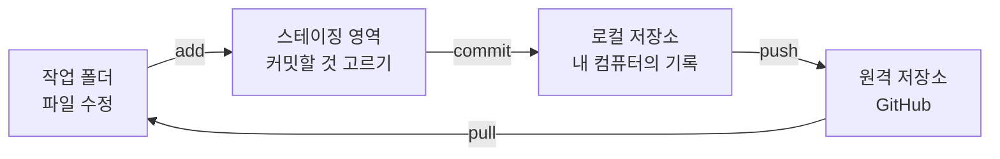

| 명령어 | 하는 일 | 비유 |
|---|---|---|
| `git init` | 현재 폴더를 **Git 저장소로 만듦** | 기록장 만들기 |
| `git add` | 변경된 파일을 **커밋 대상으로 올림** | 택배 상자에 담기 |
| `git commit` | 올린 변경을 **하나의 기록으로 저장** | 상자 봉하고 송장 쓰기 |
| `git push` | 로컬 커밋을 **원격 저장소에 올림** | 택배 보내기 |
| `git pull` | 원격의 새 변경을 **가져와서 합침** | 온 택배 받아 정리하기 |
| `git checkout` | **브랜치를 이동** (`-b`: 만들면서 이동) | 작업 공간 옮기기 |
| `git clone` | 원격 저장소 **전체를 복제** | 기록장 통째로 복사 |

- **add와 commit을 왜 나눴나?** 여러 파일을 고쳤어도 **일부만 골라** 의미 있는 단위로 커밋하기 위해서입니다.
- **commit과 push의 차이?** commit은 **내 컴퓨터에만** 기록하고, push해야 **GitHub에** 올라가서 다른 사람이 볼 수 있습니다.
- 최신 Git에서는 브랜치 이동은 `git switch`, 파일 복원은 `git restore`로 `checkout`의 역할을 나눠 쓰기도 합니다.

> 💬 "init으로 저장소를 만들고, add로 고르고, commit으로 기록하고, push로 올립니다. pull은 받아서 합치기, checkout은 브랜치 이동, clone은 저장소 전체 복사예요."

#### 개념 14. 브랜치 생성과 병합

- **브랜치:** 원본(main)에서 갈라져 나온 **독립적인 작업 공간**입니다. 브랜치에서 무엇을 해도 main에는 영향이 없습니다.
- **병합(merge):** 브랜치에서 한 작업을 **다른 브랜치(보통 main)에 합치는 것**입니다.

```bash
git checkout -b feature/login     # 브랜치를 만들고 이동
# ... 작업, add, commit ...
git checkout main                 # main으로 돌아옴
git merge feature/login           # 브랜치의 작업을 main에 합침
```

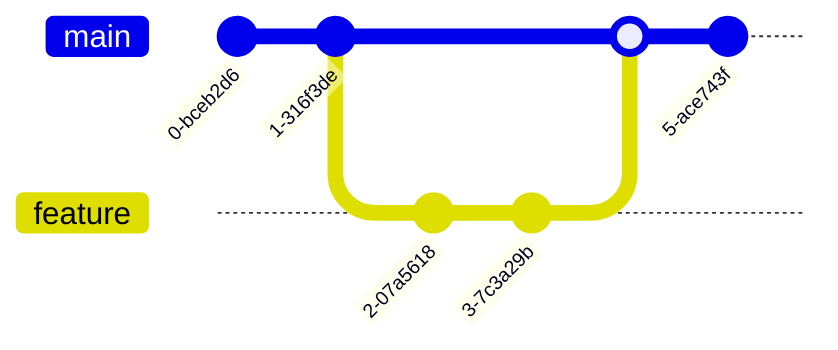

**왜 쓰나**
- **main을 항상 안정적으로:** 동작이 확인된 코드만 main에 합칩니다.
- **동시 작업:** 여러 사람이 각자 브랜치에서 일하고 나중에 합칩니다.
- **실험이 안전:** 실패하면 브랜치만 버리면 됩니다.

**함께 알아둘 것**
- **충돌(conflict):** 두 브랜치가 **같은 파일의 같은 부분**을 다르게 고쳤으면 Git이 자동으로 합치지 못합니다. 사람이 직접 골라서 고친 뒤 커밋합니다.
- **`--no-ff`:** main에 새 커밋이 없으면 Git은 병합 커밋 없이 main을 앞으로 당기기만 합니다(fast-forward). `--no-ff`를 쓰면 병합 커밋을 꼭 남겨서 갈라졌다 합쳐진 기록이 보입니다.
- **팀에서는** GitHub에서 **Pull Request**(PR)를 만들어 코드 리뷰를 받은 뒤 병합하는 경우가 많습니다.

> 💬 "브랜치는 main을 건드리지 않고 따로 작업하는 공간이에요. 작업이 끝나면 merge로 main에 합칩니다. 덕분에 main은 항상 동작하는 상태로 유지됩니다."

#### 개념 15. clone과 pull

| | `git clone` | `git pull` |
|---|---|---|
| 언제 | 저장소가 **없을 때** | 저장소가 **이미 있을 때** |
| 하는 일 | 원격 저장소 **전체**<br>(파일 + 모든 이력)를 복사 | 원격에 생긴<br>**새 변경만** 가져와 합침 |
| 횟수 | 처음 **한 번** | 작업 전마다 **수시로** |

```bash
# 처음 한 번
git clone https://github.com/사용자/저장소.git

# 이후 다른 사람(또는 다른 컴퓨터)의 변경을 받을 때
git pull
```

- **pull의 실체:** `pull` = `fetch`(원격의 새 기록 내려받기) + `merge`(내 브랜치에 합치기). 받은 변경이 내 변경과 같은 곳을 고쳤으면 **충돌**이 날 수 있습니다.
- **좋은 습관:** 작업을 시작하기 전에 먼저 `pull`로 최신 상태를 받으면 충돌을 줄일 수 있습니다.

> 💬 "clone은 저장소가 없을 때 처음 한 번 전체를 복사하는 거고, pull은 이미 있는 저장소에 새로 생긴 변경만 받아서 합치는 거예요."

---

## 1. 프로젝트 개요

터미널에서 동작하는 **4지선다 퀴즈 게임**입니다.
메뉴에서 번호를 선택해 퀴즈 풀기, 퀴즈 추가, 퀴즈 목록, 점수 확인, 퀴즈 삭제를 할 수 있습니다.
퀴즈와 최고 점수, 게임 기록은 `state.json` 파일에 저장되어 **프로그램을 종료했다가 다시 실행해도 유지**됩니다.

- **언어:** Python 3.10 이상
- **외부 라이브러리:** 없음 (표준 라이브러리 `json`, `os`, `shutil`, `random`, `datetime`, `sys`만 사용)
- **클래스:** `Quiz`(문제 1개), `QuizGame`(게임 전체), `BackupManager`(백업과 복구 기록)

## 2. 퀴즈 주제 및 선정 이유

- **주제:** Python & Git 기초 상식
- **선정 이유:** 이번 미션의 학습 목표인 Python 기초 문법(자료형, 반복문, 클래스)과 Git 명령어를 퀴즈로 만들어, 게임을 하면서 자연스럽게 복습할 수 있도록 이 주제를 선택했습니다.

## 3. 실행 방법

```bash
git clone https://github.com/bomigrace-byte/quiz-game.git
cd quiz-game
python main.py
```

> Windows에서 `python` 명령이 동작하지 않으면 `py main.py`로 실행합니다.
> 색상과 이모지는 VSCode 터미널이나 Windows Terminal에서 가장 잘 보입니다.

## 4. 기능 목록

### 메뉴

1. **퀴즈 풀기:** 풀 문제 수를 선택하면 문제를 **무작위 순서**로 출제하고, 정답/오답과 최종 점수를 보여줍니다. 최고 점수를 넘으면 갱신합니다.
2. **퀴즈 추가:** 문제, 선택지 4개, 정답 번호(1~4), 힌트(선택)를 입력받아 저장합니다.
3. **퀴즈 목록:** 등록된 문제를 번호와 함께 보여줍니다. 힌트가 있는 문제는 💡로 표시합니다.
4. **점수 확인:** 최고 점수와 최근 5회 게임 기록(날짜, 정답 수, 힌트 사용 수, 점수)을 보여줍니다.
5. **퀴즈 삭제:** 번호를 골라 퀴즈를 삭제합니다. (0 입력 또는 n 입력 시 취소)
6. **종료:** 데이터를 저장하고 종료합니다.

### 보너스 기능

- **랜덤 출제:** `random.sample`로 매번 다른 순서로 출제합니다.
- **문제 수 선택:** 1문제부터 전체 문제까지 원하는 만큼 풀 수 있습니다.
- **힌트:** 정답 입력 칸에 `h`를 입력하면 힌트를 볼 수 있습니다.
- **퀴즈 삭제:** 삭제 후 바로 파일에 반영합니다.
- **점수 기록 히스토리:** 모든 게임 기록을 날짜/시간과 함께 저장합니다.
- **화면 꾸미기:** 색상, 진행률 막대, 점수별 응원 문구를 표시합니다.
- **데이터 백업과 복구:** 저장하기 전에 자동으로 백업하고, 파일이 손상되면 사용자가 고른 백업으로 복원합니다. 복구 내역은 로그로 남깁니다. ([자세히](#데이터-백업과-복구))

### 점수 계산 규칙

- 100점 만점이며, 문제 1개의 배점은 `100 ÷ 푼 문제 수`입니다.
- 힌트 없이 맞히면 배점 전체, **힌트를 보고 맞히면 배점의 절반**, 틀리면 0점입니다.
- 최종 점수는 반올림한 정수입니다.
- 푼 문제 수가 달라도 공정하게 비교할 수 있도록, 최고 점수는 정답 개수가 아니라 **100점 만점 점수**로 비교합니다.

### 입력 및 예외 처리

- 숫자 입력은 앞뒤 공백을 제거한 뒤 처리합니다.
- 빈 입력, 숫자가 아닌 입력(`abc`), 범위 밖 숫자(`9`, `0`)는 안내 메시지를 보여주고 다시 입력받습니다.
- `Ctrl+C`(KeyboardInterrupt)나 입력 종료(EOFError)가 발생하면 데이터를 저장하고 안전하게 종료합니다.
- `state.json`이 없으면 기본 퀴즈로 시작합니다.
- `state.json`이 손상되었으면 손상된 파일을 보관한 뒤, **백업에서 복원할지 기본 데이터로 초기화할지 선택**하게 합니다.

## 5. 파일 구조

```
quiz-game/
├── main.py          # 프로그램 시작점. Ctrl+C / EOF 처리
├── quiz.py          # Quiz 클래스: 퀴즈 1문제 (출력, 정답 확인, 딕셔너리 변환)
├── quiz_game.py     # QuizGame 클래스: 메뉴, 입력 처리, 게임 진행, 저장/불러오기
├── quiz_data.py     # 기본 퀴즈 7개 (Quiz 인스턴스)
├── ui.py            # 화면 꾸미기 (색상, 구분선, 진행률 막대)
├── backup.py        # BackupManager 클래스: 백업 생성, 백업 목록, 복구 로그
├── state.json       # 저장 데이터 (실행 시 자동 생성, Git에는 올리지 않음)
├── backups/         # 백업 폴더 (자동 생성, Git에는 올리지 않음)
│   ├── state_20261117_203105.json      # 정상 백업 (최근 5개 보관)
│   ├── corrupted_20261117_203210.json  # 손상되었던 파일 보관본
│   └── recovery.log                    # 복구 기록
├── docs/
│   └── screenshots/ # 실행 화면 캡처
├── .gitignore
└── README.md
```

### 클래스 역할

**`Quiz`** (`quiz.py`): 퀴즈 **한 문제**를 표현
- 속성: `question`, `choices`, `answer`, `hint`
- 메서드: `display()`, `is_correct()`, `has_hint()`, `to_dict()`, `from_dict()`

**`QuizGame`** (`quiz_game.py`): 게임 **전체**를 관리
- 속성: `quizzes`(Quiz 목록), `best_score`, `history`
- 실행/메뉴: `run()`, `show_menu()`
- 입력 처리: `read_input()`, `get_number()`, `get_text()`, `ask_yes_no()`, `get_answer()`
- 기능: `play()`, `add_quiz()`, `list_quizzes()`, `show_score()`, `delete_quiz()`
- 결과/기록: `show_result()`, `add_history()`, `update_best_score()`
- 저장/불러오기: `load()`, `read_state()`, `save()`, `reset_to_default()`
- 복구: `recover_from_corruption()`, `find_valid_backups()`

**`BackupManager`** (`backup.py`): 백업 파일과 복구 로그를 관리
- 속성: `state_file`, `backup_dir`, `log_file`, `MAX_BACKUPS`(5)
- 메서드: `create_backup()`, `backup_corrupted()`, `list_backups()`, `write_log()`

## 6. 프로그램 실행 흐름

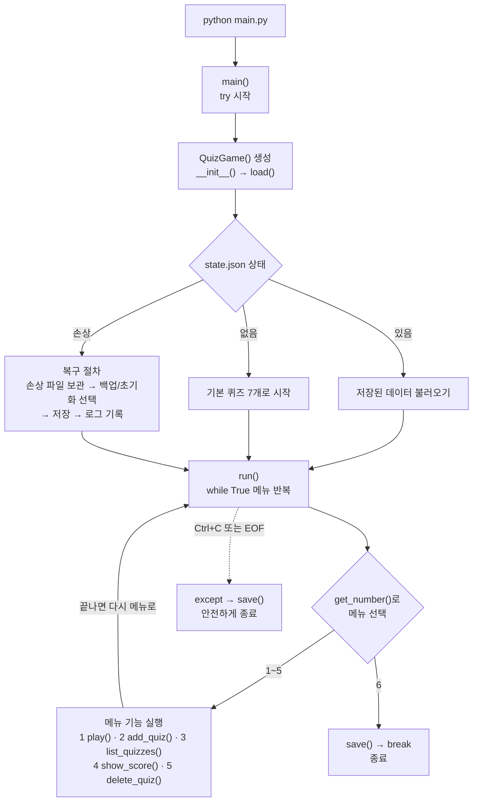

- 1~5번 기능이 끝나면 다시 메뉴(`run()`)로 돌아갑니다.
- `save()`는 `state.json`을 덮어쓰기 직전에 항상 백업을 먼저 만듭니다.

## 7. 데이터 파일 설명 (`state.json`)

- **경로:** 프로젝트 루트의 `state.json` (`main.py`와 같은 폴더)
- **역할:** 퀴즈 목록, 최고 점수, 게임 기록을 저장해서 프로그램을 다시 실행해도 데이터가 유지되게 합니다.
- **인코딩:** UTF-8 (`ensure_ascii=False`로 한글을 그대로 저장)
- **생성 시점:** 퀴즈를 풀거나, 추가/삭제하거나, 종료할 때 자동으로 만들어집니다.
- **Git 제외:** `.gitignore`에 등록해서 저장소에는 올리지 않습니다. (실행하는 사람마다 내용이 다르기 때문)

### 스키마

| 키 | 타입 | 설명 |
|---|---|---|
| `quizzes` | list | 퀴즈 목록 |
| `quizzes[].question` | str | 문제 |
| `quizzes[].choices` | list[str] | 선택지 4개 |
| `quizzes[].answer` | int | 정답 번호 (1~4) |
| `quizzes[].hint` | str | 힌트 (없으면 `""`) |
| `best_score` | int / null | 최고 점수. 기록 없으면 `null` |
| `history` | list | 게임 기록 목록 |
| `history[].date` | str | 날짜/시간 |
| `history[].total` | int | 푼 문제 수 |
| `history[].correct` | int | 맞힌 문제 수 |
| `history[].hints_used` | int | 힌트 사용 횟수 |
| `history[].score` | int | 점수 |

### 예시

```json
{
  "quizzes": [
    {
      "question": "Python에서 정수(숫자)를 나타내는 자료형은?",
      "choices": ["str", "int", "bool", "list"],
      "answer": 2,
      "hint": "integer(정수)의 줄임말입니다."
    }
  ],
  "best_score": 86,
  "history": [
    {
      "date": "2026-11-12 20:31",
      "total": 7,
      "correct": 6,
      "hints_used": 0,
      "score": 86
    }
  ]
}
```

### 데이터 백업과 복구

#### 백업 파일

| 파일 | 언제 생기나 | 보관 |
|---|---|---|
| `backups/state_시간.json` | `state.json`을 **덮어쓰기 직전** | 최근 5개 (오래된 것 자동 삭제) |
| `backups/corrupted_시간.json` | 손상된 파일을 **발견했을 때** | 삭제하지 않음 (원인 확인용) |
| `backups/recovery.log` | 복구를 **진행할 때마다** | 한 줄씩 계속 추가 |

- 파일 이름의 시간은 `연월일_시분초` 형식입니다. (예: `state_20261117_203105.json` = 2026년 11월 17일 20시 31분 05초)
- 퀴즈 추가, 삭제, 풀기, 종료로 저장할 때마다 **바로 이전 상태**가 백업으로 남습니다.
- `backups/` 폴더는 `.gitignore`에 등록해서 저장소에 올리지 않습니다.

#### 자동 복구 절차 (프로그램 실행 시)

`state.json`이 손상된 상태로 프로그램을 실행하면 아래 순서로 진행됩니다.

1. **손상 감지:** `load()`에서 JSON 문법 오류나 형식 오류가 발생
2. **손상 파일 보관:** 손상된 파일을 `backups/corrupted_시간.json`으로 복사 (지우지 않고 남겨 둠)
3. **백업 검사:** `backups/`의 백업을 최신순으로 읽어 보고, **정상적으로 읽히는 것만** 목록에 표시
4. **사용자 선택:**
   ```
   🛟 복구 방법을 선택하세요.
     0. 기본 퀴즈 데이터로 초기화
     1. 백업 state_20261117_203105.json (퀴즈 9개, 최고점수 86점)
     2. 백업 state_20261117_202950.json (퀴즈 8개, 최고점수 86점)
   선택:
   ```
   - 원하는 시점의 백업 번호를 고르면 그 버전으로 복원됩니다.
   - 사용 가능한 백업이 하나도 없으면 선택 없이 기본 데이터로 초기화합니다.
5. **저장:** 복구한 데이터를 `state.json`에 저장
6. **로그 기록:** `backups/recovery.log`에 복구 내역 기록
   ```
   [2026-11-17 20:32:10] 손상 감지 → 손상 파일 보관(corrupted_20261117_203210.json) → 백업 state_20261117_203105.json에서 복원 (사용자 선택)
   ```

> 복구 선택 도중 `Ctrl+C`로 종료하면 `state.json`은 바뀌지 않고, 다음 실행 때 다시 복구를 선택할 수 있습니다.

#### 수동 복원 절차 (원하는 시점으로 되돌리기)

파일이 손상되지 않았더라도, 실수로 퀴즈를 지웠을 때처럼 **이전 버전으로 되돌리고 싶을 때** 사용합니다.

1. 프로그램을 **종료**합니다. (실행 중에 바꾸면 종료할 때 덮어써집니다)
2. `backups/` 폴더에서 되돌리고 싶은 시간의 `state_시간.json`을 찾습니다.
3. 현재 `state.json`을 다른 이름으로 바꿔 둡니다. (예: `state_old.json`)
4. 고른 백업 파일을 프로젝트 루트에 복사한 뒤 이름을 `state.json`으로 바꿉니다.
5. `python main.py`로 실행해서 "저장된 데이터를 불러왔습니다 (퀴즈 N개...)"를 확인합니다.

Windows PowerShell 예시:
```bash
copy state.json state_old.json
copy backups\state_20261117_203105.json state.json
```

#### 복구 동작 테스트 방법

1. 퀴즈를 2~3개 추가해서 백업을 만듭니다.
2. 종료한 뒤 `state.json` 내용을 `{{{`로 바꿔 저장합니다.
3. 실행 → 복구 선택 목록이 나오는지 확인 → 백업 번호 선택
4. 목록(3번 메뉴)에서 퀴즈가 돌아왔는지, `backups/recovery.log`에 기록이 남았는지 확인

## 8. 실행 화면

| 메뉴 | 퀴즈 풀기 |
|---|---|
| 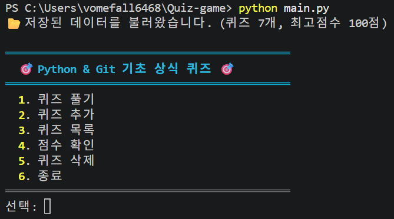 | 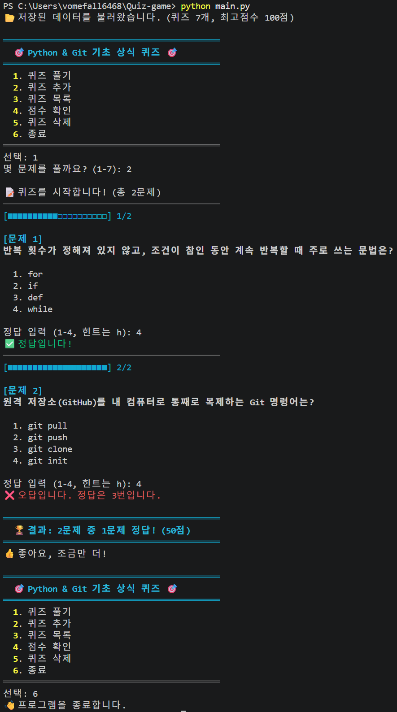 |

### 퀴즈 추가

| 추가 1 | 추가 2 | 추가 3 |
|---|---|---|
| 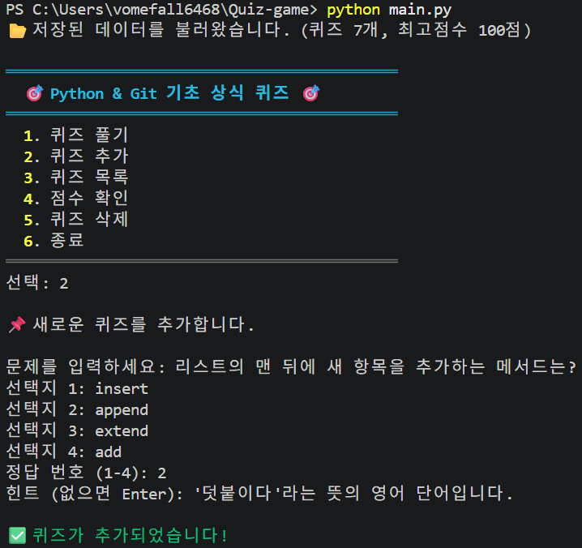 | 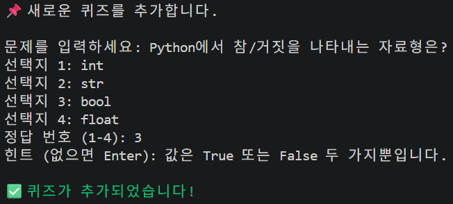 | 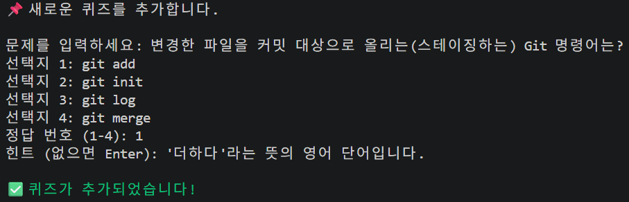 |

| 퀴즈 목록 | 점수 확인 |
|---|---|
| 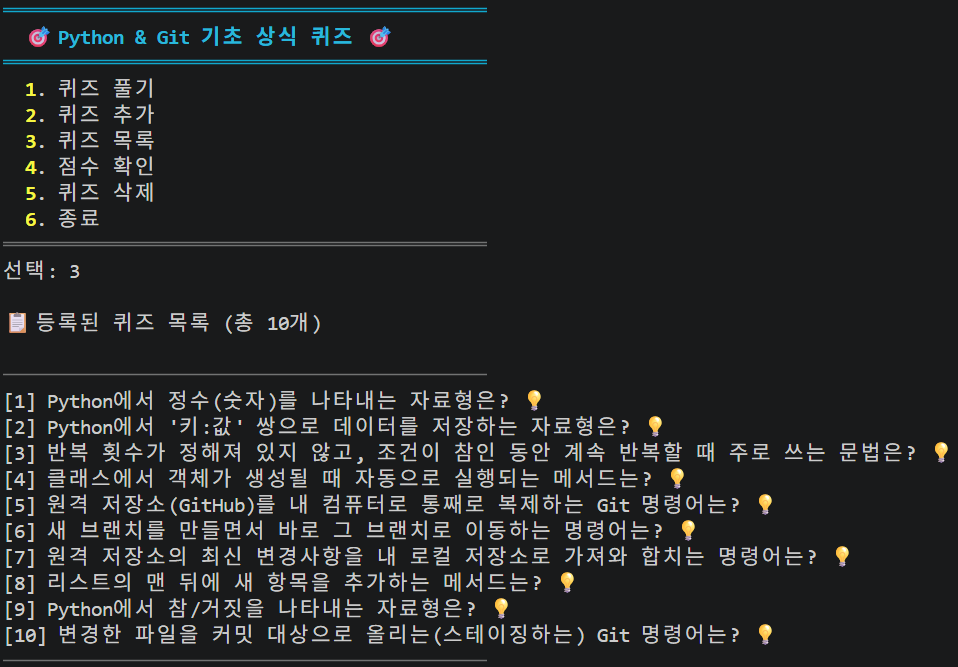 | 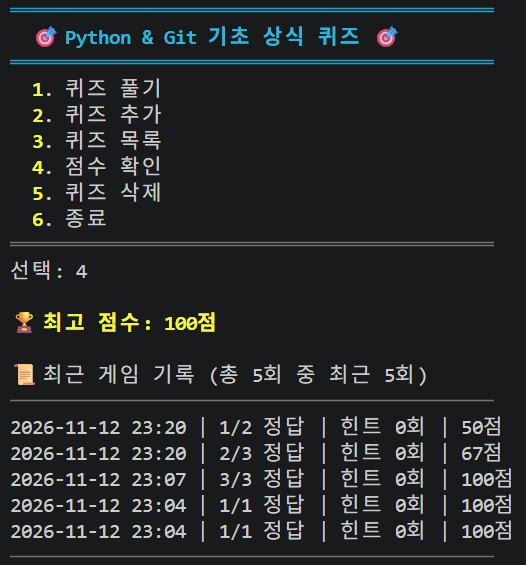 |

| 잘못된 입력 처리 |
|---|
| 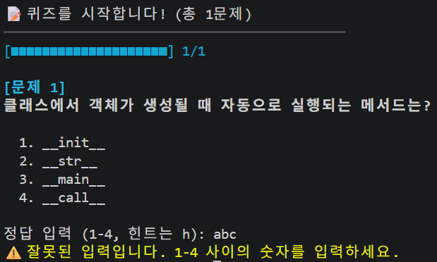 |

### 개발 환경

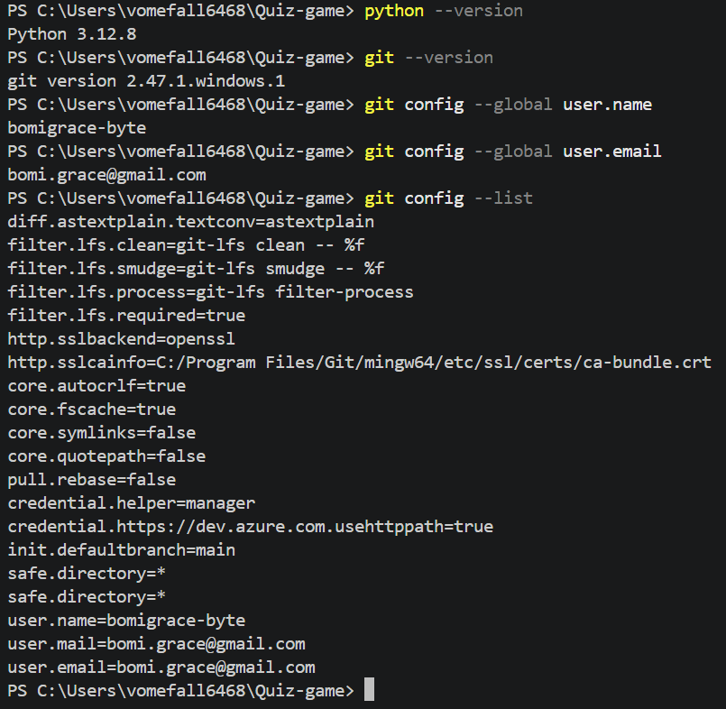

---

## 9. 개념 학습 가이드

과제 목표의 개념을 **이 프로젝트 코드로** 설명합니다.
각 항목의 "예상 질문"은 먼저 스스로 답해 본 뒤 ▶를 눌러 답을 확인하세요.

### 9-1. Python 기초

#### 변수

**값에 이름을 붙여 저장해 두는 상자**입니다. 같은 값을 여러 곳에서 쓰거나, 값이 바뀌는 상황을 추적할 때 사용합니다.

```python
# quiz_game.py - play()
correct = 0        # 맞힌 개수를 기억하는 변수
correct += 1       # 맞힐 때마다 1씩 증가
```

`correct`라는 이름 덕분에 "지금까지 몇 개 맞혔는지"를 반복문이 도는 동안 계속 기억할 수 있습니다.

<details>
<summary>예상 질문: 변수를 왜 사용하나요?</summary>

값을 저장해 두었다가 나중에 다시 쓰거나 바꾸기 위해서입니다. 예를 들어 `correct` 변수가 없으면 문제를 풀 때마다 맞힌 개수를 기억할 방법이 없습니다. 또 `per_question = 100 / total`처럼 계산 결과에 이름을 붙이면 코드의 의미가 분명해집니다.
</details>

#### 자료형: int, str, bool, list, dict

| 자료형 | 의미 | 이 프로젝트에서 |
|---|---|---|
| `int` | 정수 | `answer`(정답 번호), `correct`, `score` |
| `str` | 문자열 | `question`, `hint`, `input()`의 결과 |
| `bool` | 참/거짓 | `used_hint`, `is_correct()`의 반환값 |
| `list` | 순서 있는 묶음 | `choices`(선택지 4개), `quizzes`, `history` |
| `dict` | 키:값 묶음 | `to_dict()` 결과, 게임 기록 1건(`record`) |

```python
# quiz.py - Quiz.__init__()
self.question = question  # str
self.choices = choices    # list
self.answer = answer      # int

# quiz_game.py - add_history()
record = {                # dict: 이름(키)으로 값을 찾음
    "date": ...,
    "score": score,
}
```

- **list는 번호(인덱스)로**, **dict는 이름(키)으로** 값을 꺼냅니다. `choices[0]` vs `record["score"]`
- **`input()`은 항상 str을 돌려줍니다.** 그래서 숫자로 쓰려면 `int(text)`로 바꿔야 합니다.

<details>
<summary>예상 질문: list와 dict는 언제 각각 쓰나요?</summary>

순서가 중요하고 같은 종류의 값을 여러 개 담을 때는 list를 씁니다. 선택지 4개, 퀴즈 목록이 그렇습니다. 값마다 의미(이름)가 다를 때는 dict를 씁니다. 게임 기록 1건에는 날짜, 문제 수, 점수처럼 서로 다른 의미의 값이 들어 있어서 dict로 만들었습니다.
</details>

<details>
<summary>예상 질문: 입력받은 "3"과 숫자 3은 같은가요?</summary>

다릅니다. `input()`으로 받은 `"3"`은 str이고, `3`은 int입니다. `"3" == 3`은 False입니다. 그래서 `get_number()`에서 `int(text)`로 변환한 뒤 정답 번호(int)와 비교합니다.
</details>

#### 조건문: if / elif / else

조건에 따라 **다른 동작**을 하게 만듭니다. 위에서부터 차례로 검사해서, 처음으로 참인 블록 **하나만** 실행합니다.

```python
# quiz_game.py - run()
if choice == 1:
    self.play()
elif choice == 2:
    self.add_quiz()
...
else:              # 1~5가 아니면 (= 6, 종료)
    self.save()
    break
```

<details>
<summary>예상 질문: if를 여러 개 쓰는 것과 if/elif를 쓰는 것의 차이는?</summary>

`if`를 여러 개 쓰면 모든 조건을 각각 검사하고, 참인 것은 전부 실행합니다. `if/elif`는 처음 참인 조건 하나만 실행하고 나머지는 건너뜁니다. 메뉴 선택처럼 **여러 경우 중 하나만** 골라야 할 때는 `elif`가 맞습니다.
</details>

#### 반복문: for vs while

| | for | while |
|---|---|---|
| 언제 | **반복 횟수가<br>정해져 있을 때** | **조건이 만족될 때까지**<br>(횟수를 모를 때) |
| 사용한 곳 | 선택한 문제 수만큼 출제<br>(`play()`) | 메뉴 반복 (`run()`)<br>올바른 입력이 들어올 때까지<br>(`get_number()`) |

```python
# for: 선택한 문제들을 하나씩 꺼냄 (횟수 = 문제 수)
for i, quiz in enumerate(selected, start=1):
    quiz.display(i)

# while: 올바른 숫자가 들어올 때까지 계속 (몇 번 틀릴지 모름)
while True:
    text = self.read_input(prompt)
    ...
    return number   # 올바르면 함수를 끝내며 반복 탈출
```

- `continue`: 반복문의 **처음으로** 돌아감 (잘못된 입력 → 다시 입력받기)
- `break`: 반복문을 **빠져나감** (메뉴에서 종료 선택)
- `enumerate(목록, start=1)`: 값과 함께 **1부터 시작하는 번호**를 같이 꺼냄

<details>
<summary>예상 질문: 메뉴는 왜 while이고, 퀴즈 출제는 왜 for인가요?</summary>

메뉴는 사용자가 종료를 고를 때까지 몇 번 반복될지 알 수 없어서 `while True`와 `break`를 사용했습니다. 퀴즈 출제는 선택한 문제 수만큼만 반복하면 되므로, 목록을 하나씩 꺼내는 `for`가 더 간단하고 실수가 적습니다.
</details>

<details>
<summary>예상 질문: continue와 break의 차이는?</summary>

`continue`는 이번 반복의 남은 코드를 건너뛰고 반복문의 처음으로 돌아갑니다. `get_number()`에서 잘못된 입력이 들어오면 `continue`로 다시 입력받습니다. `break`는 반복문 자체를 끝냅니다. `run()`에서 종료를 선택하면 `break`로 메뉴 반복을 끝냅니다.
</details>

#### 함수: 정의, 매개변수, 반환값

**자주 쓰는 동작을 묶어 이름을 붙인 것**입니다. 매개변수로 값을 받고, `return`으로 결과를 돌려줍니다.

```python
# quiz_game.py
def get_number(self, prompt, min_value, max_value):   # 매개변수 3개
    ...
    return number                                    # 반환값: 검증된 정수

# 같은 함수를 범위만 바꿔서 여러 곳에서 재사용
choice = self.get_number("선택: ", 1, 6)                    # 메뉴
answer = self.get_number("정답 번호 (1-4): ", 1, 4)          # 퀴즈 추가
number = self.get_number("삭제할 퀴즈 번호 ...", 0, total)    # 삭제
```

<details>
<summary>예상 질문: get_number를 함수로 만든 이유는?</summary>

숫자 입력 검증(공백 제거, 빈 입력, 숫자 변환 실패, 범위 확인)이 메뉴, 정답 번호, 문제 수, 삭제 번호 등 여러 곳에서 필요합니다. 함수로 한 번만 만들고 매개변수로 범위만 바꿔 재사용하면 코드 중복이 없고, 검증 규칙을 바꿀 때도 한 곳만 고치면 됩니다.
</details>

<details>
<summary>예상 질문: 반환값이 2개인 함수가 있나요?</summary>

`get_answer()`는 `return number, used_hint`로 정답 번호와 힌트 사용 여부를 함께 돌려줍니다. 받는 쪽에서 `answer, used_hint = self.get_answer(quiz)`처럼 두 변수로 나눠 받습니다. (실제로는 튜플 하나를 돌려주고 풀어서 받는 것입니다.)
</details>

### 9-2. 클래스와 객체

#### 클래스란?

**데이터(속성)와 그 데이터를 다루는 기능(메서드)을 하나로 묶은 설계도**입니다. 설계도로 실제로 만든 것이 **객체**(인스턴스)입니다.

```python
# quiz_data.py - 같은 설계도(Quiz)로 서로 다른 객체 7개를 만듦
Quiz("Python에서 정수를 나타내는 자료형은?", ["str", "int", "bool", "list"], 2, "...")
Quiz("클래스에서 객체가 생성될 때 자동으로 실행되는 메서드는?", [...], 1, "...")
```

**이 프로젝트에서 클래스를 2개로 나눈 이유**
- `Quiz`: 문제 **한 개**에 대한 책임 (자기 내용 출력, 정답 확인, 저장 형식 변환)
- `QuizGame`: 게임 **전체**에 대한 책임 (메뉴, 입력, 점수, 파일 저장)

<details>
<summary>예상 질문: 클래스를 왜 사용하나요? 딕셔너리로도 되지 않나요?</summary>

딕셔너리로 문제를 저장할 수는 있지만, "정답 확인"이나 "화면 출력" 같은 기능이 데이터와 따로 떨어진 함수가 됩니다. 클래스를 쓰면 `quiz.is_correct(3)`처럼 데이터와 기능을 함께 다룰 수 있어 코드가 읽기 쉽고, 문제 관련 코드를 수정할 때 `quiz.py`만 보면 됩니다. 역할별로 코드를 나눠 관리하기 위해 사용합니다.
</details>

#### `__init__`과 `self`

- **`__init__`**: 객체가 **만들어질 때 자동으로 한 번 실행**되는 메서드입니다. 속성의 처음 값을 정합니다.
- **`self`**: **지금 만들어지는(또는 사용 중인) 그 객체 자신**을 가리킵니다.

```python
# quiz.py
def __init__(self, question, choices, answer, hint=""):
    self.question = question   # "이 객체의" question에 저장
    self.answer = answer

def is_correct(self, user_answer):
    return user_answer == self.answer   # "이 객체의" 정답과 비교
```

`quiz1.is_correct(2)`를 호출하면 `self`는 `quiz1`이 되고, `quiz2.is_correct(2)`를 호출하면 `self`는 `quiz2`가 됩니다. 그래서 같은 메서드가 객체마다 **자기 정답**과 비교할 수 있습니다.

`hint=""`는 **기본값**입니다. 힌트를 넘기지 않으면 빈 문자열이 됩니다.

<details>
<summary>예상 질문: self를 빼면 어떻게 되나요?</summary>

`self.answer = answer` 대신 `answer = answer`라고 쓰면 메서드 안에서만 쓰이는 임시 변수가 되어, `__init__`이 끝나는 순간 사라집니다. `self.`를 붙여야 객체에 저장되어 다른 메서드(`is_correct` 등)에서도 쓸 수 있습니다.
</details>

<details>
<summary>예상 질문: QuizGame의 __init__은 무엇을 하나요?</summary>

빈 퀴즈 목록, 최고 점수 `None`, 빈 기록 목록으로 속성을 준비한 뒤 `self.load()`를 호출해서 저장된 데이터를 불러옵니다. 그래서 `QuizGame()`을 만드는 순간 게임을 시작할 준비가 끝납니다.
</details>

#### 속성(attribute)과 메서드(method)

- **속성:** 객체가 가진 **데이터** → `quiz.question`, `game.best_score` (괄호 없음)
- **메서드:** 객체가 할 수 있는 **동작** → `quiz.display(1)`, `game.save()` (괄호 있음)

**클래스 속성**은 모든 객체가 공유하는 값입니다. `QuizGame.MENU_ITEMS`가 그렇습니다. 메뉴를 추가하면 `run()`의 입력 범위 `len(self.MENU_ITEMS)`가 자동으로 바뀝니다.

#### `@classmethod`와 `from_dict()`

```python
# quiz.py
@classmethod
def from_dict(cls, data):
    ...
    return cls(question, choices, answer, hint)   # cls = Quiz
```

이미 있는 객체가 아니라 **딕셔너리로부터 새 객체를 만드는** 메서드라서, `self` 대신 클래스 자체(`cls`)를 받는 `@classmethod`로 만들었습니다. `to_dict()`(객체 → dict, 저장용)와 짝을 이룹니다.

<details>
<summary>예상 질문: to_dict와 from_dict는 왜 필요한가요?</summary>

JSON 파일에는 Quiz 객체를 그대로 저장할 수 없고, 딕셔너리나 리스트 같은 기본 자료형만 저장할 수 있습니다. 그래서 저장할 때는 `to_dict()`로 객체를 딕셔너리로 바꾸고, 불러올 때는 `from_dict()`로 딕셔너리를 다시 객체로 만듭니다. `from_dict()`는 이때 데이터가 올바른지(선택지 4개, 정답 1~4)도 검사합니다.
</details>

### 9-3. 파일 입출력과 예외 처리

#### 파일 열기 / 읽기 / 쓰기

```python
# 읽기 - load()
with open(STATE_FILE, "r", encoding="utf-8") as f:
    data = json.load(f)

# 쓰기 - save()
with open(STATE_FILE, "w", encoding="utf-8") as f:
    json.dump(data, f, ensure_ascii=False, indent=2)
```

- **`"r"` / `"w"`**: 읽기 모드 / 쓰기 모드 (`"w"`는 기존 내용을 지우고 새로 씀)
- **`encoding="utf-8"`**: 한글이 깨지지 않도록 인코딩을 지정
- **`with`**: 블록이 끝나면 **파일을 자동으로 닫아 줌** (오류가 나도 닫힘)

**파일 경로를 고정한 이유**
```python
STATE_FILE = os.path.join(os.path.dirname(os.path.abspath(__file__)), "state.json")
```
`__file__`은 지금 코드 파일의 위치입니다. 이렇게 하면 어느 폴더에서 실행하든 항상 **프로젝트 루트**에 `state.json`이 저장됩니다.

<details>
<summary>예상 질문: with를 쓰지 않으면 어떤 문제가 있나요?</summary>

`f = open(...)`으로 열면 작업이 끝난 뒤 `f.close()`를 직접 호출해야 합니다. 중간에 오류가 나면 close가 실행되지 않아 파일이 열린 채로 남거나, 쓴 내용이 제대로 저장되지 않을 수 있습니다. `with`는 블록을 벗어나면 오류가 나도 자동으로 파일을 닫아 줍니다.
</details>

#### JSON

**JSON**은 데이터를 `{ }`(객체), `[ ]`(배열), 문자열, 숫자, `true/false`, `null`로 표현하는 **텍스트 형식**입니다.

| Python | JSON |
|---|---|
| dict | `{ }` |
| list | `[ ]` |
| str | `"문자열"` |
| int | 숫자 |
| True / False | `true` / `false` |
| None | `null` |

- `json.dump()`: Python 데이터 → JSON 파일
- `json.load()`: JSON 파일 → Python 데이터
- `ensure_ascii=False`: 한글을 `안` 같은 코드 대신 그대로 저장
- `indent=2`: 사람이 읽기 좋게 들여쓰기

<details>
<summary>예상 질문: 왜 JSON으로 저장했나요?</summary>

첫째, Python의 dict/list와 구조가 거의 같아서 변환이 쉽습니다. 둘째, 텍스트 파일이라 사람이 직접 열어서 내용을 확인하거나 고칠 수 있습니다. 셋째, 표준 라이브러리 `json`만으로 처리할 수 있어 외부 라이브러리가 필요 없습니다.
</details>

<details>
<summary>예상 질문: best_score가 None일 때 JSON에는 어떻게 저장되나요?</summary>

`null`로 저장됩니다. 다시 불러오면 Python의 `None`으로 돌아옵니다. 그래서 "아직 퀴즈를 풀지 않음"을 0점과 구분해서 표현할 수 있습니다.
</details>

#### try / except

오류가 날 수 있는 코드를 `try`에 넣고, 오류가 나면 프로그램이 멈추는 대신 `except`에서 처리합니다.

**① 숫자 변환 실패 처리** (`get_number()`)
```python
try:
    number = int(text)
except ValueError:          # "abc"는 int로 바꿀 수 없음
    ui.warn("잘못된 입력입니다...")
    continue                # 다시 입력받기
```

**② 파일 오류를 종류별로 처리** (`load()`)
```python
try:
    ...파일 읽기, 데이터 검사...
except FileNotFoundError:                 # 파일 없음 (첫 실행)
    기본 퀴즈로 시작
except (json.JSONDecodeError, KeyError, TypeError, AttributeError, ValueError):
    손상 안내 → recover_from_corruption() (백업 선택 복구)
except OSError:                           # 권한 문제 등 기타 파일 오류
    기본 퀴즈로 시작
```

| 오류 | 언제 발생하나 |
|---|---|
| `FileNotFoundError` | 파일이 없음 |
| `json.JSONDecodeError` | JSON 문법이 깨짐 (`{{{`) |
| `KeyError` | 필요한 키가 없음 (`"quizzes"` 없음) |
| `TypeError` | 자료형이 다름 (목록 자리에 숫자) |
| `ValueError` | 값이 규칙에 안 맞음 (선택지 3개, 정답 9) |
| `OSError` | 권한 등 기타 파일 오류 |

**except 순서가 중요한 이유:** `FileNotFoundError`는 `OSError`의 한 종류입니다. `except OSError`를 먼저 쓰면 "파일 없음"도 거기서 잡혀 버리므로, **구체적인 오류를 위에, 넓은 오류를 아래에** 둡니다.

**③ 비정상 종료 방지** (`main.py`)
```python
try:
    game = QuizGame()
    game.run()
except (KeyboardInterrupt, EOFError):   # Ctrl+C, 입력 종료
    ui.warn("입력이 중단되어 프로그램을 종료합니다.")
    if game is not None:
        game.save()
```

<details>
<summary>예상 질문: 데이터 파일이 손상되면 어떻게 동작하나요?</summary>

`load()`에서 JSON 문법 오류나 형식 오류(`KeyError`, `ValueError` 등)가 발생하면 except가 잡아서 `recover_from_corruption()`을 호출합니다. 손상된 파일을 `backups/corrupted_시간.json`으로 보관하고, 정상적으로 읽히는 백업 목록을 보여준 뒤 사용자가 고른 백업으로 복원하거나 기본 데이터로 초기화합니다. 마지막으로 저장하고 `recovery.log`에 기록합니다. 프로그램은 멈추지 않고 계속 실행됩니다.
</details>

<details>
<summary>예상 질문: 그냥 except Exception으로 전부 잡으면 안 되나요?</summary>

전부 잡으면 어떤 문제였는지 구분할 수 없어서, "파일 없음"과 "파일 손상"에 다른 안내를 할 수 없습니다. 또 내 코드의 버그까지 숨겨 버릴 수 있습니다. 그리고 `KeyboardInterrupt`는 `Exception`에 속하지 않아서 `except Exception`으로는 Ctrl+C를 잡을 수도 없습니다. 그래서 예상되는 오류를 종류별로 명시했습니다.
</details>

<details>
<summary>예상 질문: if game is not None은 왜 있나요?</summary>

`QuizGame()`을 만드는 도중(예: 불러오기 중)에 Ctrl+C가 눌리면 `game`에 아직 객체가 들어가지 않은 상태(`None`)입니다. 이때 `game.save()`를 호출하면 또 다른 오류가 나기 때문에, 객체가 만들어진 경우에만 저장합니다.
</details>

#### 백업에 쓰인 파일 다루기 (`backup.py`)

```python
shutil.copy2(self.state_file, backup_path)       # 파일 복사 (수정 시간 정보까지 유지)
os.makedirs(self.backup_dir, exist_ok=True)      # 폴더 만들기 (이미 있어도 오류 없음)
names = os.listdir(self.backup_dir)              # 폴더 안 파일 이름 목록
os.remove(old_path)                              # 파일 삭제 (오래된 백업 정리)

with open(self.log_file, "a", encoding="utf-8") as f:   # "a": 기존 내용 뒤에 추가
    f.write(f"[{now}] {message}\n")
```

| 모드 | 의미 | 사용한 곳 |
|---|---|---|
| `"r"` | 읽기 | `read_state()` |
| `"w"` | 덮어쓰기 (기존 내용 삭제) | `save()` |
| `"a"` | 뒤에 추가 (기존 내용 유지) | `write_log()` |

**백업 정리 원리:** 파일 이름에 `연월일_시분초`가 들어 있어서 **이름순 정렬 = 시간순 정렬**입니다. `sort(reverse=True)`로 최신순으로 정렬한 뒤 `[5:]`(6번째 이후)를 삭제합니다.

<details>
<summary>예상 질문: 백업 기능을 왜 QuizGame이 아니라 별도 클래스로 만들었나요?</summary>

백업 파일 만들기, 목록 찾기, 오래된 백업 정리, 로그 쓰기는 "게임 진행"과 다른 책임이기 때문입니다. `BackupManager`로 분리하면 `QuizGame`은 "언제 백업할지"만 결정하고, "어떻게 백업할지"는 `backup.py`만 보면 됩니다. 백업 개수나 폴더 위치를 바꿀 때도 `backup.py`만 수정하면 됩니다.
</details>

<details>
<summary>예상 질문: 복구한 뒤 저장할 때는 왜 백업을 만들지 않나요? (make_backup=False)</summary>

복구 직후의 `state.json`은 **손상된 파일**입니다. 이때 평소처럼 저장 전에 백업하면 손상된 파일이 정상 백업(`state_시간.json`)으로 들어가서, 다음 복구 때 선택지에 섞이고 좋은 백업 하나를 밀어내게 됩니다. 손상 파일은 이미 `corrupted_시간.json`으로 따로 보관했으므로 `save(make_backup=False)`로 저장합니다.
</details>

<details>
<summary>예상 질문: 백업 파일도 손상되어 있으면 어떻게 되나요?</summary>

`find_valid_backups()`가 각 백업을 `read_state()`로 실제로 읽어 보고, 예외가 나는 백업은 `continue`로 건너뜁니다. 그래서 선택 목록에는 정상적으로 읽히는 백업만 나옵니다. 정상 백업이 하나도 없으면 자동으로 기본 데이터로 초기화합니다.
</details>

### 9-4. 보너스 기능에 쓰인 개념

**리스트 인덱스는 0부터** (`delete_quiz()`)
```python
target = self.quizzes[number - 1]   # 화면 번호 1 = 리스트 인덱스 0
self.quizzes.pop(number - 1)
```

**random.sample** (`play()`)
```python
selected = random.sample(self.quizzes, total)
```
원본 목록은 그대로 두고, `total`개를 **무작위 순서로 뽑은 새 리스트**를 돌려줍니다. 랜덤 출제와 문제 수 선택을 한 번에 해결합니다.

**리스트 슬라이싱** (`show_score()`)
```python
recent = self.history[-5:]        # 뒤에서 5개 = 최근 기록 5개
for record in reversed(recent):   # 최신 기록부터 출력
```

**dict.get(키, 기본값)** (`from_dict()`, `load()`)
```python
hint = data.get("hint", "")        # 키가 없으면 "" 사용
history = data.get("history", [])
```
`data["hint"]`는 키가 없으면 KeyError가 나지만, `get()`은 기본값을 돌려줍니다. 힌트·기록 기능이 생기기 **전에 저장된 파일**도 오류 없이 읽을 수 있습니다. (하위 호환성)

**datetime** (`add_history()`)
```python
datetime.now().strftime("%Y-%m-%d %H:%M")   # "2026-11-12 20:31"
```

<details>
<summary>예상 질문: 힌트를 본 문제의 점수는 어떻게 계산하나요?</summary>

`get_answer()`가 정답 번호와 함께 `used_hint`(True/False)를 돌려줍니다. `play()`에서 정답이면서 `used_hint`가 True면 `earned += per_question / 2`로 배점의 절반만 더하고, False면 배점 전체를 더합니다. 마지막에 `round(earned)`로 반올림해서 최종 점수를 만듭니다.
</details>

### 9-5. Git 기초

#### Git이란? 왜 필요한가?

Git은 **파일의 변경 이력을 기록하는 버전 관리 도구**입니다.
- 언제, 무엇을, 왜 바꿨는지 기록이 남습니다.
- 문제가 생기면 이전 상태로 되돌릴 수 있습니다.
- 브랜치로 기능을 따로 개발하고 합칠 수 있어서 **여러 사람이 동시에 작업**할 수 있습니다.

#### Git이 파일을 다루는 4개의 공간

```
작업 폴더  ──add──▶  스테이징  ──commit──▶  로컬 저장소  ──push──▶  원격 저장소(GitHub)
(파일 수정)          (커밋할 파일 선택)       (내 컴퓨터의 기록)    ◀──pull──  (공유 공간)
```

#### 명령어 7종

| 명령어 | 하는 일 | 이 프로젝트에서 |
|---|---|---|
| `git init` | 폴더를 Git 저장소로 만듦 | 1단계에서 한 번 |
| `git add` | 변경된 파일을 커밋 대상으로 올림 | 매 커밋 전 |
| `git commit` | 올린 변경을 하나의 기록으로 저장 | 기능 하나 완성할 때마다 |
| `git push` | 로컬 기록을 GitHub에 올림 | 커밋 후 |
| `git pull` | GitHub의 새 기록을 가져와 합침 | clone 실습 후 원래 폴더에서 |
| `git checkout` | 브랜치를 이동 (`-b`: 만들면서 이동) | 기능별 브랜치 작업 |
| `git clone` | 원격 저장소 전체를 새 폴더로 복제 | clone/pull 실습 |

#### 브랜치와 병합

```bash
git checkout -b feature/hint          # 새 브랜치를 만들고 이동
# ...작업, add, commit...
git checkout main                     # main으로 돌아옴
git merge --no-ff feature/hint -m "Merge: feature/hint 병합"
```

- **브랜치:** main을 건드리지 않고 **독립적으로 작업하는 갈래**입니다. 작업이 실패해도 main은 안전합니다.
- **merge:** 브랜치의 작업을 main에 합칩니다.
- **`--no-ff`:** 합칠 때 **병합 커밋을 꼭 남기는** 옵션입니다. 그래프에 "갈라졌다 합쳐진" 기록이 보입니다.

#### clone과 pull의 차이

- **clone:** 내 컴퓨터에 저장소가 **없을 때**, 처음 한 번 전체를 복사합니다.
- **pull:** 저장소가 **이미 있을 때**, 새로 생긴 변경사항만 가져와 합칩니다.

<details>
<summary>예상 질문: add와 commit을 왜 나눠 놓았나요?</summary>

여러 파일을 고쳤어도 그중 **일부만 골라서** 하나의 커밋으로 묶을 수 있게 하기 위해서입니다. 예를 들어 기능 코드와 README를 같이 고쳤을 때, 기능 코드만 add해서 "Feat" 커밋을 하고 README는 따로 "Docs" 커밋을 할 수 있습니다.
</details>

<details>
<summary>예상 질문: commit과 push의 차이는?</summary>

commit은 **내 컴퓨터(로컬 저장소)에** 기록을 남기는 것이고, push는 그 기록을 **GitHub(원격 저장소)에** 올리는 것입니다. commit만 하면 다른 사람은 내 변경을 볼 수 없습니다.
</details>

<details>
<summary>예상 질문: 브랜치를 왜 사용하나요?</summary>

main은 항상 동작하는 상태로 유지하고, 새 기능은 별도 브랜치에서 개발하기 위해서입니다. 기능이 완성되어 확인이 끝난 다음에만 main에 병합하므로, 작업 중에 코드가 꼬여도 main에는 영향이 없습니다. 팀 작업에서는 각자 다른 브랜치에서 동시에 작업할 수 있습니다.
</details>

<details>
<summary>예상 질문: pull은 내부적으로 무엇을 하나요?</summary>

pull은 `fetch`(원격 저장소의 새 기록을 내려받기)와 `merge`(내 브랜치에 합치기)를 한 번에 하는 명령입니다.
</details>

<details>
<summary>예상 질문: state.json은 왜 Git에 올리지 않았나요?</summary>

실행할 때마다 내용이 바뀌는 **사용자 데이터**이기 때문입니다. 올리면 사람마다 다른 점수와 퀴즈가 충돌을 일으킬 수 있습니다. 대신 `.gitignore`에 등록하고, 파일이 없으면 기본 퀴즈로 시작하도록 만들었습니다.
</details>

---

## 10. 동료 평가 코드 설명 포인트

동료 평가에서 코드를 설명할 때 아래 **순서**로 보여주면 프로그램 전체 흐름이 자연스럽게 전달됩니다. (약 5~7분)

**1. 시작점 - `main.py`의 `main()`**
- 무엇: `QuizGame` 객체를 만들고 `run()`으로 게임을 시작합니다.
- 포인트: 전체를 `try`로 감싸서 Ctrl+C·입력 종료에도 저장 후 안전하게 종료합니다. → [9-3 ③](#try--except)

**2. 클래스 설계 - `Quiz`와 `QuizGame`**
- 무엇: 문제 1개(`Quiz`)와 게임 전체(`QuizGame`)로 책임을 나눴습니다.
- 포인트: `__init__`에서 속성 준비, `self`가 각 객체를 가리킴. → [9-2](#9-2-클래스와-객체)

**3. 데이터 불러오기 - `QuizGame.load()`**
- 무엇: `state.json`을 읽고 `Quiz.from_dict()`로 객체를 만듭니다.
- 포인트: 파일 없음/손상/읽기 오류를 except 3개로 나눠 처리하고, 구체적인 오류부터 잡습니다. → [9-3 ②](#try--except)

**4. 메뉴 반복 - `QuizGame.run()`**
- 무엇: `while True`로 메뉴를 반복하고, `if/elif/else`로 기능을 실행합니다.
- 포인트: 종료를 고를 때만 `save()` 후 `break`. → [9-1 조건문](#조건문-if--elif--else)

**5. 입력 검증 - `QuizGame.get_number()`**
- 무엇: 공백 제거 → 빈 입력 → 숫자 변환 실패 → 범위 확인, 4단계를 모두 통과해야 반환합니다.
- 포인트: 매개변수로 범위만 바꿔서 메뉴·정답·삭제 등 여러 곳에서 재사용합니다. → [9-1 함수](#함수-정의-매개변수-반환값)

**6. 퀴즈 진행과 점수 - `QuizGame.play()`**
- 무엇: `random.sample`로 문제를 뽑고, `for`로 출제하고, 정답이면 점수를 누적합니다.
- 포인트: 힌트를 쓰면 절반 점수, 100점 만점으로 계산해서 최고 점수와 비교합니다. → [9-4](#9-4-보너스-기능에-쓰인-개념)

**7. 힌트 입력 - `QuizGame.get_answer()`**
- 무엇: 숫자 대신 `h`가 들어오면 힌트를 보여주고 다시 입력받습니다.
- 포인트: `(정답 번호, 힌트 사용 여부)` 두 값을 반환합니다.

**8. 저장 - `QuizGame.save()`, `Quiz.to_dict()`**
- 무엇: 객체를 dict로 바꿔 `json.dump()`로 UTF-8 저장합니다.
- 포인트: `ensure_ascii=False`(한글 유지), `with`(자동 닫기). → [9-3](#파일-열기--읽기--쓰기)

**9. 삭제 - `QuizGame.delete_quiz()`**
- 무엇: 번호 선택 → y/n 확인 → `pop()` → 저장.
- 포인트: 화면 번호는 1부터, 인덱스는 0부터라서 `number - 1`. 0이나 n이면 취소.

**10. 백업과 복구 - `BackupManager`, `QuizGame.recover_from_corruption()`**
- 무엇: 저장 전에 자동 백업(최근 5개 유지), 손상 시 손상 파일 보관 → 정상 백업 목록 → 사용자 선택 → 저장 → 로그.
- 포인트: 백업 책임을 별도 클래스로 분리했고, 복구 저장 때는 `make_backup=False`로 손상 파일이 백업에 섞이지 않게 합니다. → [7. 데이터 백업과 복구](#데이터-백업과-복구)

**11. 시연 순서 (실행 화면으로 보여주기)**
1. 메뉴에서 `abc`, `9`, 빈 입력 → 재입력 (예외 처리)
2. 퀴즈 풀기: 문제 수 선택 → 힌트(`h`) 사용 → 결과와 최고 점수
3. 퀴즈 추가 → 목록에서 확인
4. 종료 후 다시 실행 → "저장된 데이터를 불러왔습니다" (데이터 유지)
5. `state.json`을 `{{{`로 망가뜨리고 실행 → 백업 선택해서 복원 → `recovery.log` 확인
6. `git log --oneline --graph`로 브랜치/병합 기록

---

## 11. Git 작업 기록

- **원격 저장소:** https://github.com/bomigrace-byte/quiz-game
- **총 커밋 수:** 26개 이상 (`git rev-list --count HEAD`로 확인, 스크린샷 기준 26개 이후 문서 커밋 추가)
- **사용한 Git 명령어:** `init`, `add`, `commit`, `push`, `pull`, `checkout`, `clone`, `merge`

### 브랜치 및 병합 이력

기능과 문서 작업마다 별도 브랜치에서 작업한 뒤 `git merge --no-ff`로 `main`에 병합했습니다.

| 브랜치 | 작업 내용 |
|---|---|
| `feature/play` | 퀴즈 풀기 |
| `feature/random` | 랜덤 출제 |
| `feature/count` | 문제 수 선택 |
| `feature/hint` | 힌트 및 점수 차감 |
| `feature/delete` | 퀴즈 삭제 |
| `feature/history` | 게임 기록 히스토리 |
| `feature/ui` | 터미널 색상 및 진행률 표시 |
| `feature/backup` | 데이터 백업과 복구 |
| `feature/landing` | 프로젝트 소개 웹페이지 (GitHub Pages) |
| `feature/readme-design` | README 배너와 카드 레이아웃 |
| `feature/learning-goals` | 학습 목표 달성 현황 정리 |
| `feature/readme-layout` | README 표 정렬, 줄바꿈, 실행 흐름도 개선 |
| `feature/readme-toc` | 목차와 기능 카드를 가운데 정렬 레이아웃으로 변경 |
| `feature/basic-concepts` | 학습 목표의 기본 개념 정리 (README, 랜딩 페이지) |
| `feature/goals-list` | 학습 목표 현황을 표에서 항목 목록으로 변경 |

### `git log --oneline --graph` 출력

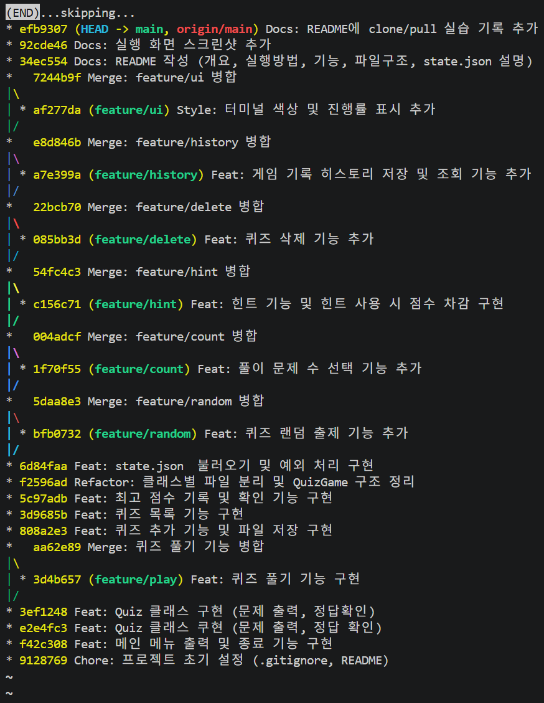

### 커밋 수 확인

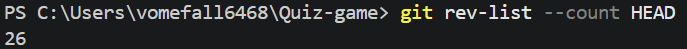

### clone / pull 실습

1. 원격 저장소를 `quiz-game-clone` 폴더로 `clone`
2. clone한 저장소에서 README에 한 줄 추가 → `commit` → `push`
3. 원래 작업 폴더에서 `pull` → README에 변경사항이 반영된 것을 확인

## 12. 커밋 규칙

### 커밋 단위

- **기능 하나 = 커밋 하나:** 메뉴, Quiz 클래스, 퀴즈 풀기, 추가, 목록, 점수, 저장처럼 **실행해서 확인할 수 있는 기능 단위**로 커밋합니다.
- **커밋 전에 반드시 실행해서 동작을 확인합니다.** 동작하지 않는 상태는 커밋하지 않습니다.
- **새 기능은 브랜치에서 작업합니다:** `feature/기능이름` 브랜치에서 작업한 뒤 `main`에 병합합니다.

### 메시지 템플릿

```
타입: 변경 내용 요약 (한 줄, 무엇을 했는지)
```

| 타입 | 언제 쓰나 | 예시 |
|---|---|---|
| `Feat` | 새 기능 | `Feat: 퀴즈 풀기 기능 구현` |
| `Fix` | 버그 수정 | `Fix: 점수 계산 오류 수정` |
| `Refactor` | 구조 개선 | `Refactor: 클래스별 파일 분리` |
| `Style` | 화면/모양 | `Style: 터미널 색상 추가` |
| `Docs` | 문서 | `Docs: README 실행 방법 추가` |
| `Chore` | 설정 등 | `Chore: .gitignore 추가` |
| `Merge` | 병합 | `Merge: feature/play 병합` |

## 13. 대량 데이터 처리 분석 (퀴즈 1,000개 이상)

### 측정 결과

완성 코드로 퀴즈 수를 늘려 가며 직접 측정했습니다. (Python 3.13 기준, PC 성능에 따라 달라질 수 있음)

| 퀴즈 수 | 파일 크기 | 불러오기 | 저장 | 메모리 |
|---|---|---|---|---|
| 1,000개 | 약 258KB | 약 0.02초 | 약 0.01초 | 약 1MB |
| 10,000개 | 약 2.5MB | 약 0.18초 | 약 0.1초 | 약 10MB |
| 100,000개 | 약 25MB | 약 2.3초 | 약 0.8초 | 약 106MB |

**결론:** 1,000개 수준에서는 속도와 메모리 모두 문제가 없습니다. 퀴즈 수에 비례해서 시간과 메모리가 늘어나기 때문에, **10만 개 수준부터는 실행 시작과 저장할 때 체감되는 지연**이 생깁니다.

### 현재 구조의 한계

- **불러오기**
  - 현재: 실행할 때 `state.json` 전체를 읽어서 메모리(list)에 올림
  - 한계: 데이터가 커질수록 시작이 느려지고 메모리를 많이 씀
- **저장**
  - 현재: 추가/삭제/풀기를 할 때마다 **파일 전체를 다시 씀**
  - 한계: 1문제만 바뀌어도 전체를 저장함
- **목록 보기**
  - 현재: 모든 문제를 한 번에 출력
  - 한계: 1,000줄이 출력되면 화면에서 찾기 어려움 (속도보다 사용성 문제)
- **검색**
  - 현재: 검색 기능 없음. 구현한다면 처음부터 끝까지 하나씩 비교(선형 탐색)
  - 한계: 데이터 수에 비례해서 느려짐
- **게임 기록**
  - 현재: `history`가 계속 쌓이기만 함
  - 한계: 오래 사용하면 파일이 계속 커짐

### 개선 방안

**바로 적용 가능**

- **목록 페이징:** 한 번에 20개씩 보여주고 `n`(다음)/`p`(이전)로 이동
  → 1,000개도 화면에서 보기 쉬움
- **기록 개수 제한:** `history`는 최근 100개까지만 보관
  → 파일이 끝없이 커지는 것을 방지
- **저장 횟수 줄이기:** 변경할 때마다 저장하지 않고, 종료할 때와 일정 횟수마다 저장
  → 저장 비용 감소 (대신 강제 종료 시 일부 데이터를 잃을 수 있음)

**중간 단계**

- **검색용 인덱스:** 카테고리나 키워드별로 문제 번호를 모아 둔 dict를 만들어 사용
  → 매번 전체를 훑지 않고 바로 찾음

**10만 개 이상**

- **DB 전환:** 표준 라이브러리 `sqlite3`로 바꿔서 필요한 문제만 조회하고, 바뀐 행만 저장
  → 전체를 메모리에 올리지 않아도 되고, 저장도 바뀐 부분만 처리

<details>
<summary>예상 질문: 왜 1,000개는 괜찮고 10만 개는 느린가요?</summary>

실행할 때 파일 전체를 메모리에 올리고, 저장할 때도 파일 전체를 다시 쓰기 때문에 걸리는 시간과 메모리가 데이터 양에 비례해서 늘어납니다. 1,000개는 0.02초 수준이라 체감되지 않지만, 10만 개는 시작할 때 2초 넘게 걸립니다.
</details>

## 14. 요구사항 변경 시 수정 위치

코드를 역할별로 나눠 두었기 때문에, 요구사항이 바뀌면 아래 위치만 수정하면 됩니다.

### 파일별 역할 요약

- `quiz.py` → **퀴즈 모델** (`Quiz` 클래스: 문제 1개의 데이터와 동작)
- `quiz_data.py` → **기본 퀴즈 데이터** (`get_default_quizzes()`)
- `quiz_game.py` → **게임 진행** (`QuizGame` 클래스: 메뉴, 입력, 점수, 저장/불러오기)
- `ui.py` → **화면 출력** (색상, 구분선, 진행률)
- `backup.py` → **백업과 복구 로그** (`BackupManager` 클래스)
- `main.py` → **프로그램 시작과 비정상 종료 처리**

### 변경 사례별 수정 대상

**1. 점수 계산 규칙 변경** (예: 힌트 감점을 절반 → 30%로, 오답 감점 추가)
- `QuizGame.play()` 안의 점수 계산 부분 (`per_question`, `earned` 계산)
- `QuizGame.show_result()` → 결과 안내 문구
- `QuizGame.update_best_score()` → 최고 점수 비교 기준이 바뀌는 경우
- README "점수 계산 규칙"

**2. 퀴즈 모델 변경** (예: 카테고리, 해설 필드 추가)
- `Quiz.__init__()` → 속성 추가
- `Quiz.to_dict()` / `Quiz.from_dict()` → 저장/불러오기 필드 추가
  (예전 파일과 호환되도록 `data.get("필드", 기본값)` 사용)
- `Quiz.display()` → 화면에 보여줄 경우
- `QuizGame.add_quiz()` → 새 필드 입력받기
- `quiz_data.py` → 기본 퀴즈에 값 채우기

**3. 선택지 개수 변경** (예: 4지선다 → 5지선다)
- `Quiz.from_dict()` → 선택지 개수 검사 (`len(choices) != 4`)
- `QuizGame.add_quiz()` → 선택지 입력 반복 횟수(`range(1, 5)`)와 정답 번호 범위
- `QuizGame.get_answer()` → 정답 입력 범위(1~4)와 안내 문구
- `quiz_data.py` → 기본 퀴즈 선택지 추가

**4. 데이터 저장 구조 변경** (예: 필드 추가, 파일 위치 변경, DB 전환)
- `STATE_FILE` (`quiz_game.py` 상단) → 저장 파일 경로
- `QuizGame.save()` → 저장할 데이터 구성
- `QuizGame.load()` → 불러오기와 형식 검사, 예외 처리
- `QuizGame.reset_to_default()` → 파일이 없거나 손상됐을 때의 초기값
- `Quiz.to_dict()` / `Quiz.from_dict()` → 퀴즈 1개의 저장 형식
- README "데이터 파일 설명"

**5. 메뉴 기능 추가/변경**
- `QuizGame.MENU_ITEMS` → 메뉴 이름 목록 (메뉴 번호 범위는 자동으로 따라감)
- `QuizGame.run()` → 선택 번호에 따른 `elif` 분기
- 새 기능용 메서드 추가 (예: `search_quiz()`)

**6. 입력 규칙 변경** (예: 빈 입력 허용, 다른 문자로 힌트 보기)
- `QuizGame.get_number()` → 숫자 입력 검증
- `QuizGame.get_text()` → 문자열 입력 검증
- `QuizGame.ask_yes_no()` → y/n 확인
- `QuizGame.get_answer()` → 정답 입력과 힌트(`h`) 처리

**7. 게임 기록 변경** (예: 보관 개수 제한, 표시 개수 변경)
- `QuizGame.add_history()` → 기록 항목 구성, 보관 개수 제한
- `QuizGame.RECENT_HISTORY_COUNT` → 점수 확인 화면에 보여줄 개수
- `QuizGame.show_score()` → 기록 출력 형식

**8. 퀴즈 주제 / 기본 문제 변경**
- `quiz_data.py`의 `get_default_quizzes()`만 수정

**9. 화면 디자인 변경** (색상, 구분선, 문구)
- `ui.py` → 색상 코드, 구분선 길이(`WIDTH`), 응원 문구(`score_message()`)
- `QuizGame.show_menu()`, `QuizGame.show_result()` → 화면 구성

**10. 종료 처리 변경** (Ctrl+C, 입력 종료 시 동작)
- `main.py`의 `main()` → `KeyboardInterrupt`, `EOFError` 처리

**11. 백업/복구 정책 변경** (예: 백업 개수, 백업 폴더 위치, 자동 복구로 변경)
- `BackupManager.MAX_BACKUPS` → 보관할 백업 개수
- `BackupManager.__init__()` → 백업 폴더와 로그 파일 경로
- `BackupManager.create_backup()` → 백업 만드는 방식
- `QuizGame.save()` → 언제 백업할지 (`make_backup` 매개변수)
- `QuizGame.recover_from_corruption()` → 복구 순서, 사용자 선택 여부 (예: 선택 없이 최신 백업 자동 복원)

### 수정 후 확인할 것

1. `python main.py`로 바뀐 기능 실행
2. `state.json`을 지우고 실행 → 기본 퀴즈로 시작되는지 확인
3. **예전 `state.json`으로 실행** → 오류 없이 불러와지는지 확인 (저장 구조를 바꾼 경우)
4. 잘못된 입력(`abc`, 빈 입력, 범위 밖 숫자) → 다시 입력받는지 확인

<details>
<summary>예상 질문: 점수 계산을 왜 별도 메서드로 분리하지 않았나요?</summary>

현재는 점수 계산이 출제 흐름과 함께 진행되어서 `play()` 안에 두었습니다. 점수 규칙이 자주 바뀐다면 `calculate_score()` 같은 메서드로 분리하는 게 좋습니다. 그러면 점수 규칙을 바꿀 때 `play()`의 출제 흐름을 건드리지 않아도 됩니다.
</details>

## 15. 과제 목표 셀프 체크리스트

각 항목을 **코드를 보지 않고 말로 설명**할 수 있으면 체크하세요. 막히면 옆의 링크를 다시 읽으세요.

**Python 기초**
- [ ] 변수가 무엇이고 왜 쓰는지 → [9-1 변수](#변수)
- [ ] `int`, `str`, `bool`, `list`, `dict`의 차이 → [9-1 자료형](#자료형-int-str-bool-list-dict)
- [ ] `if/elif/else`로 메뉴를 분기하는 방법 → [9-1 조건문](#조건문-if--elif--else)
- [ ] `for`와 `while`의 차이와 선택 이유 → [9-1 반복문](#반복문-for-vs-while)
- [ ] 함수의 매개변수와 반환값 (`get_number`) → [9-1 함수](#함수-정의-매개변수-반환값)

**클래스와 객체**
- [ ] 클래스가 무엇이고 왜 2개로 나눴는지 → [9-2](#클래스란)
- [ ] `__init__`과 `self`의 역할 → [9-2](#__init__과-self)
- [ ] 속성과 메서드의 차이 → [9-2](#속성attribute과-메서드method)

**파일 입출력**
- [ ] 파일을 열고, 읽고, 쓰는 과정과 `with`의 역할 → [9-3](#파일-열기--읽기--쓰기)
- [ ] JSON이 무엇이고 왜 썼는지 → [9-3 JSON](#json)
- [ ] `try/except`로 처리한 오류의 종류와 순서 → [9-3 try/except](#try--except)
- [ ] 백업을 언제 만들고, 손상 시 어떻게 복구하는지 → [7. 데이터 백업과 복구](#데이터-백업과-복구)

**Git 기초**
- [ ] Git이 무엇이고 왜 필요한지 → [9-5](#git이란-왜-필요한가)
- [ ] `init`, `add`, `commit`, `push`, `pull`, `checkout`, `clone`의 역할 → [9-5 명령어](#명령어-7종)
- [ ] 브랜치 생성과 병합 방법 → [9-5 브랜치](#브랜치와-병합)
- [ ] `clone`과 `pull`의 차이 → [9-5](#clone과-pull의-차이)
