# 🎯 Python & Git 기초 상식 퀴즈

## 1. 프로젝트 개요

터미널에서 동작하는 **4지선다 퀴즈 게임**입니다.
메뉴에서 번호를 선택해 퀴즈 풀기, 퀴즈 추가, 퀴즈 목록, 점수 확인, 퀴즈 삭제를 할 수 있습니다.
퀴즈와 최고 점수, 게임 기록은 `state.json` 파일에 저장되어 **프로그램을 종료했다가 다시 실행해도 유지**됩니다.

- 언어: Python 3.10 이상
- 외부 라이브러리: 없음 (표준 라이브러리 `json`, `os`, `random`, `datetime`, `sys`만 사용)

## 2. 퀴즈 주제 및 선정 이유

- **주제:** Python & Git 기초 상식
- **선정 이유:** 이번 미션의 학습 목표인 Python 기초 문법(자료형, 반복문, 클래스)과 Git 명령어를 퀴즈로 만들어, 게임을 하면서 자연스럽게 복습할 수 있도록 이 주제를 선택했습니다.

## 3. 실행 방법

```bash
git clone https://github.com/<bomigrace-byte>/quiz-game.git
cd quiz-game
python main.py
```

> Windows에서 `python` 명령이 동작하지 않으면 `py main.py`로 실행합니다.

## 4. 기능 목록

1. **퀴즈 풀기**: 풀 문제 수를 선택하면 문제를 **무작위 순서**로 출제하고, 정답/오답과 최종 점수를 보여줍니다. 최고 점수를 넘으면 갱신합니다.
2. **퀴즈 추가**: 문제, 선택지 4개, 정답 번호(1~4), 힌트(선택)를 입력받아 저장합니다.
3. **퀴즈 목록**: 등록된 문제를 번호와 함께 보여줍니다. 힌트가 있는 문제는 💡로 표시합니다.
4. **점수 확인**: 최고 점수와 최근 5회 게임 기록(날짜, 정답 수, 힌트 사용 수, 점수)을 보여줍니다.
5. **퀴즈 삭제**: 번호를 골라 퀴즈를 삭제합니다. (0 입력 또는 n 입력 시 취소)
6. **종료**: 데이터를 저장하고 종료합니다.

### 보너스 기능

- **랜덤 출제:** `random.sample`로 매번 다른 순서로 출제합니다.
- **문제 수 선택:** 1문제부터 전체 문제까지 원하는 만큼 풀 수 있습니다.
- **힌트:** 정답 입력 칸에 `h`를 입력하면 힌트를 볼 수 있습니다.
- **퀴즈 삭제:** 삭제 후 바로 파일에 반영합니다.
- **점수 기록 히스토리:** 모든 게임 기록을 날짜/시간과 함께 저장합니다.
- **화면 꾸미기:** 색상, 진행률 막대, 점수별 응원 문구를 표시합니다.

### 점수 계산 규칙

- 100점 만점이며, 문제 1개의 배점은 `100 ÷ 푼 문제 수`입니다.
- 힌트 없이 맞히면 배점 전체, **힌트를 보고 맞히면 배점의 절반**, 틀리면 0점입니다.
- 최종 점수는 반올림한 정수입니다. 푼 문제 수가 달라도 공정하게 비교할 수 있도록 최고 점수는 이 100점 만점 점수로 비교합니다.

### 입력 및 예외 처리

- 숫자 입력은 앞뒤 공백을 제거한 뒤 처리합니다.
- 빈 입력, 숫자가 아닌 입력(`abc`), 범위 밖 숫자(`9`, `0`)는 안내 메시지를 보여주고 다시 입력받습니다.
- `Ctrl+C`(KeyboardInterrupt)나 입력 종료(EOFError)가 발생하면 데이터를 저장하고 안전하게 종료합니다.
- `state.json`이 없으면 기본 퀴즈로 시작하고, 손상되었으면 안내 메시지를 보여준 뒤 기본 퀴즈 데이터로 복구합니다.

## 5. 파일 구조

```
quiz-game/
├── main.py          # 프로그램 시작점. Ctrl+C / EOF 처리
├── quiz.py          # Quiz 클래스: 퀴즈 1문제 (출력, 정답 확인, 딕셔너리 변환)
├── quiz_game.py     # QuizGame 클래스: 메뉴, 입력 처리, 게임 진행, 저장/불러오기
├── quiz_data.py     # 기본 퀴즈 7개 (Quiz 인스턴스)
├── ui.py            # 화면 꾸미기 (색상, 구분선, 진행률 막대)
├── state.json       # 저장 데이터 (실행 시 자동 생성, Git에는 올리지 않음)
├── docs/
│   └── screenshots/ # 실행 화면 캡처
├── .gitignore
└── README.md
```

### 클래스 역할

| 클래스 | 속성 | 주요 메서드 |
|---|---|---|
| `Quiz` | `question`, `choices`, `answer`, `hint` | `display()`, `is_correct()`, `has_hint()`, `to_dict()`, `from_dict()` |
| `QuizGame` | `quizzes`, `best_score`, `history` | `run()`, `show_menu()`, `play()`, `add_quiz()`, `list_quizzes()`, `show_score()`, `delete_quiz()`, `load()`, `save()`, `get_number()` |

## 6. 데이터 파일 설명 (`state.json`)

- **경로:** 프로젝트 루트의 `state.json` (`main.py`와 같은 폴더)
- **역할:** 퀴즈 목록, 최고 점수, 게임 기록을 저장해서 프로그램을 다시 실행해도 데이터가 유지되게 합니다.
- **인코딩:** UTF-8 (`ensure_ascii=False`로 한글을 그대로 저장)
- **생성 시점:** 첫 실행 후 퀴즈를 풀거나, 추가/삭제하거나, 종료할 때 자동으로 만들어집니다.
- `.gitignore`에 등록해서 저장소에는 올리지 않습니다. (실행하는 사람마다 내용이 다르기 때문)

### 스키마

| 키 | 타입 | 설명 |
|---|---|---|
| `quizzes` | list | 퀴즈 목록 |
| `quizzes[].question` | str | 문제 |
| `quizzes[].choices` | list[str] | 선택지 4개 |
| `quizzes[].answer` | int | 정답 번호 (1~4) |
| `quizzes[].hint` | str | 힌트 (없으면 빈 문자열) |
| `best_score` | int 또는 null | 최고 점수 (100점 만점). 아직 풀지 않았으면 `null` |
| `history` | list | 게임 기록 목록 |
| `history[].date` | str | 플레이 날짜/시간 (`YYYY-MM-DD HH:MM`) |
| `history[].total` | int | 푼 문제 수 |
| `history[].correct` | int | 맞힌 문제 수 |
| `history[].hints_used` | int | 힌트 사용 횟수 |
| `history[].score` | int | 점수 |

### 예시

```json
{
  "quizzes": [
    {
      "question": "Python에서 정수(숫자)를 나타내는 자료형은?",
      "choices": ["str", "int", "bool", "list"],
      "answer": 2,
      "hint": "integer(정수)의 줄임말입니다."
    }
  ],
  "best_score": 86,
  "history": [
    {
      "date": "2026-11-12 20:31",
      "total": 7,
      "correct": 6,
      "hints_used": 0,
      "score": 86
    }
  ]
}
```

## 7. 실행 화면

| 메뉴 | 퀴즈 풀기 |
|---|---|
| 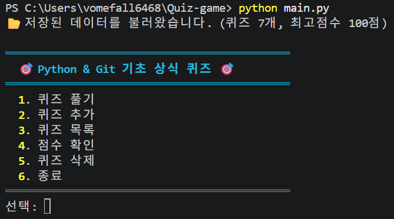 | 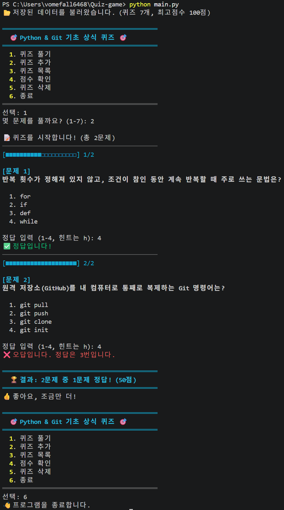 |

### 퀴즈 추가

| 추가 1 | 추가 2 | 추가 3 |
|---|---|---|
| 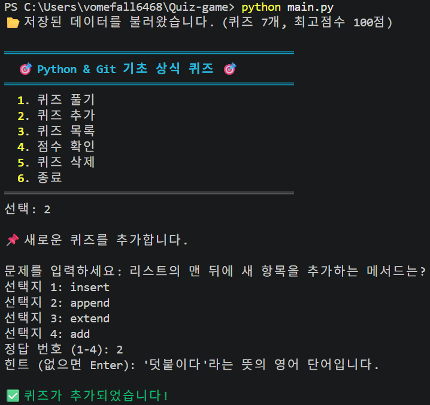 | 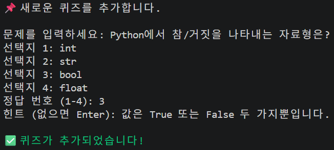 | 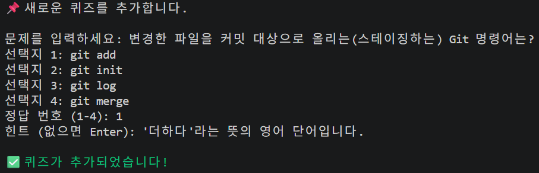 |

| 퀴즈 목록 | 점수 확인 |
|---|---|
| 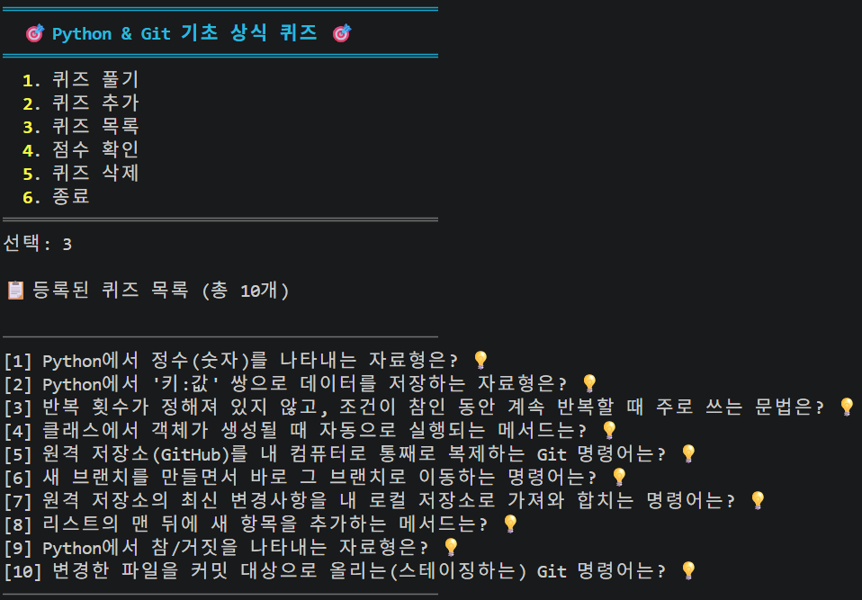 | 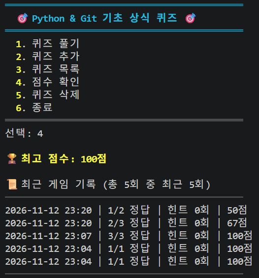 |

| 잘못된 입력 처리 |
|---|
| 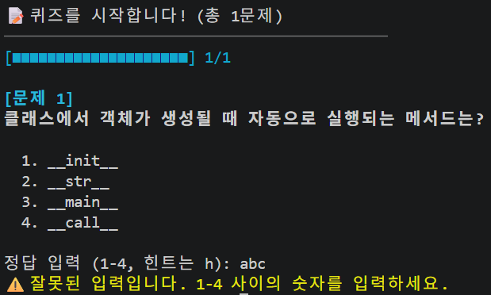 |

### 개발 환경

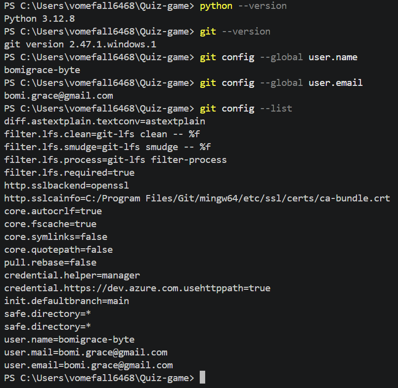

## 8. Git 작업 기록

- **원격 저장소:** https://github.com/bomigrace-byte/quiz-game
- **총 커밋 수:** 26개 (`git rev-list --count HEAD` 결과)
- **사용한 Git 명령어:** `init`, `add`, `commit`, `push`, `pull`, `checkout`, `clone`, `merge`

### 브랜치 및 병합 이력

기능마다 별도 브랜치에서 작업한 뒤 `git merge --no-ff`로 `main`에 병합했습니다. (`--no-ff`를 써서 병합 기록이 그래프에 남도록 함)

| 브랜치 | 작업 내용 |
|---|---|
| `feature/play` | 퀴즈 풀기 |
| `feature/random` | 랜덤 출제 |
| `feature/count` | 문제 수 선택 |
| `feature/hint` | 힌트 및 점수 차감 |
| `feature/delete` | 퀴즈 삭제 |
| `feature/history` | 게임 기록 히스토리 |
| `feature/ui` | 터미널 색상 및 진행률 표시 |

### `git log --oneline --graph` 출력

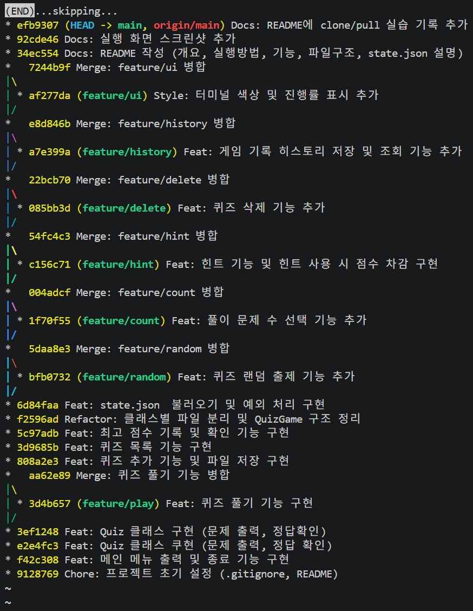

### 커밋 수 확인

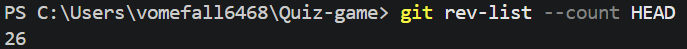

### clone / pull 실습

1. 원격 저장소를 `quiz-game-clone` 폴더로 `clone`
2. clone한 저장소에서 README에 한 줄 추가 → `commit` → `push`
3. 원래 작업 폴더에서 `pull` → README에 변경사항이 반영된 것을 확인

## 9. 커밋 규칙

### 커밋 단위

- **기능 하나 = 커밋 하나:** 메뉴, Quiz 클래스, 퀴즈 풀기, 추가, 목록, 점수, 저장처럼 **실행해서 확인할 수 있는 기능 단위**로 커밋합니다.
- **커밋 전에 반드시 실행해서 동작을 확인합니다.** 동작하지 않는 상태는 커밋하지 않습니다.
- **새 기능은 브랜치에서 작업합니다:** `feature/기능이름` 브랜치에서 작업한 뒤 `main`에 병합합니다.

### 메시지 템플릿

```
타입: 변경 내용 요약 (한 줄, 무엇을 했는지)
```

| 타입 | 언제 쓰나 | 예시 |
|---|---|---|
| `Feat` | 새 기능 추가 | `Feat: 퀴즈 풀기 기능 구현` |
| `Fix` | 버그 수정 | `Fix: 점수 계산 오류 수정` |
| `Refactor` | 동작은 같고 코드 구조만 개선 | `Refactor: 클래스별 파일 분리` |
| `Style` | 화면 출력, 코드 모양 변경 | `Style: 터미널 색상 추가` |
| `Docs` | 문서 수정 | `Docs: README 실행 방법 추가` |
| `Chore` | 설정 등 기타 작업 | `Chore: .gitignore 추가` |
| `Merge` | 브랜치 병합 | `Merge: feature/play 병합` |

## 10. 대량 데이터 처리 분석 (퀴즈 1,000개 이상)

### 측정 결과

완성 코드로 퀴즈 수를 늘려 가며 직접 측정했습니다. (Python 3.13 기준, PC 성능에 따라 달라질 수 있음)

| 퀴즈 수 | state.json 크기 | 불러오기 | 저장 | 메모리 사용 |
|---|---|---|---|---|
| 1,000개 | 약 258KB | 약 0.02초 | 약 0.01초 | 약 1MB |
| 10,000개 | 약 2.5MB | 약 0.18초 | 약 0.1초 | 약 10MB |
| 100,000개 | 약 25MB | 약 2.3초 | 약 0.8초 | 약 106MB |

**결론:** 1,000개 수준에서는 속도와 메모리 모두 문제가 없습니다. 퀴즈 수에 비례해서 시간과 메모리가 늘어나기 때문에, **10만 개 수준부터는 실행 시작과 저장할 때 체감되는 지연**이 생깁니다.

### 현재 구조의 한계

| 항목 | 현재 방식 | 한계 |
|---|---|---|
| 불러오기 | 실행할 때 `state.json` 전체를 읽어서 메모리(list)에 올림 | 데이터가 커질수록 시작이 느려지고 메모리를 많이 씀 |
| 저장 | 추가/삭제/풀기를 할 때마다 **파일 전체를 다시 씀** | 1문제만 바뀌어도 전체를 저장함 |
| 목록 보기 | 모든 문제를 한 번에 출력 | 1,000줄이 출력되면 화면에서 찾기 어려움 (속도보다 사용성 문제) |
| 검색 | 검색 기능 없음. 구현한다면 처음부터 끝까지 하나씩 비교(선형 탐색) | 데이터 수에 비례해서 느려짐 |
| 게임 기록 | `history`가 계속 쌓이기만 함 | 오래 사용하면 파일이 계속 커짐 |

### 개선 방안

| 단계 | 개선 방법 | 효과 |
|---|---|---|
| 바로 적용 가능 | **목록 페이징:** 한 번에 20개씩 보여주고 `n`(다음)/`p`(이전)로 이동 | 1,000개도 화면에서 보기 쉬움 |
| 바로 적용 가능 | **기록 개수 제한:** `history`는 최근 100개까지만 보관 | 파일이 끝없이 커지는 것을 방지 |
| 바로 적용 가능 | **저장 횟수 줄이기:** 변경할 때마다 저장하지 않고, 종료할 때와 일정 횟수마다 저장 | 저장 비용 감소 (대신 강제 종료 시 일부 데이터를 잃을 수 있음) |
| 중간 | **검색용 인덱스:** 카테고리나 키워드별로 문제 번호를 모아 둔 dict를 만들어 사용 | 매번 전체를 훑지 않고 바로 찾음 |
| 10만 개 이상 | **DB 전환:** 표준 라이브러리 `sqlite3`로 바꿔서 필요한 문제만 조회하고, 바뀐 행만 저장 | 전체를 메모리에 올리지 않아도 되고, 저장도 바뀐 부분만 처리 |

> 이 줄은 clone한 저장소에서 추가한 뒤 push했습니다. (clone/pull 실습)
